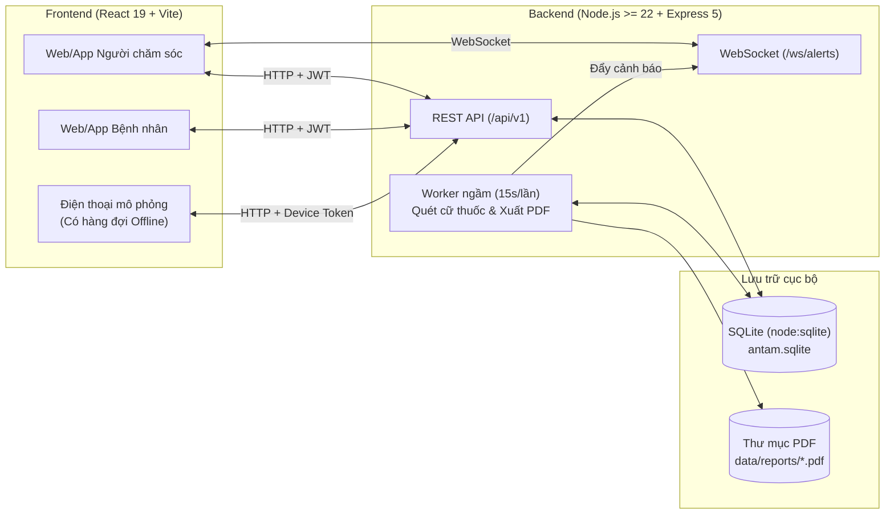

# Tổng Quan Mã Nguồn An Tâm v1.0 (Tài Liệu Ôn Tập & Bảo Vệ Đồ Án)

Tài liệu tóm tắt ngắn gọn cấu trúc mã nguồn, luồng chạy và các điểm kỹ thuật cốt lõi của hệ thống **An Tâm v1.0** — *Hỗ trợ người chăm sóc theo dõi điều trị ngoại trú cho bệnh nhân cao tuổi mắc đái tháo đường type 2 (BV Hữu Nghị)*.

---

## 1. Bức Tranh Toàn Cảnh & Công Nghệ

Hệ thống chạy theo mô hình **Client–Server** (khi đóng gói có thể chạy chung trên **1 cổng `8080`**, khi phát triển chạy Vite ở `5173` nối sang Backend `8080`):

| Thành phần | Công nghệ sử dụng | Lý do chọn / Vai trò chính |
| :--- | :--- | :--- |
| **Runtime & CSDL** | **Node.js >= 22** + **`node:sqlite`** | Dùng SQLite tích hợp sẵn trong Node (không cần cài DB rời khi chạy local), bật chế độ `WAL` và `FOREIGN KEY`. |
| **Backend API** | **Express 5** + **Zod** | Định tuyến `/api/v1`; dùng `Zod` kiểm tra chặt mọi dữ liệu đầu vào (Body, Query, UUID). |
| **Bảo mật** | **jose** (JWT) + **`node:crypto`** | Ký JWT `HS256` (15 phút), băm mật khẩu bằng `scrypt`, băm token/mã PIN bằng `SHA-256`, mã hóa push token bằng `AES-256-GCM`. |
| **Thời gian thực & PDF** | **ws** + **pdfkit** | Đẩy cảnh báo bỏ lỡ thuốc tức thì qua WebSocket; dựng báo cáo PDF tiếng Việt chuẩn A4. |
| **Frontend** | **React 19** + **Vite 6** | SPA gọn nhẹ, tự quản lý state/cache qua Context (`AppContext.jsx`, `query.js`), không phụ thuộc thư viện nặng. |

---

## 2. Bản Đồ Thư Mục (Nhìn Nhanh Biết File Nào Làm Gì)

### Backend (`backend/src/`) — 11 tệp mã nguồn
| Tệp | Trách nhiệm chính |
| :--- | :--- |
| [server.js](../backend/src/server.js) | Điểm khởi chạy: mở cổng HTTP, gắn WebSocket và chạy vòng lặp **Worker mỗi 15 giây**. |
| [app.js](../backend/src/app.js) | Tạo Express app, đối tượng ngữ cảnh `ctx`, kiểm tra CORS, phục vụ file tĩnh `frontend/dist` và bắt lỗi tập trung. |
| [config.js](../backend/src/config.js) & [common.js](../backend/src/common.js) | Đọc cấu hình `.env`, tự sinh khóa tại `data/local-keys.json`, định nghĩa hằng số nghiệp vụ và hàm xử lý ngày giờ **UTC+07**. |
| [db.js](../backend/src/db.js) | Khởi tạo 16 bảng SQLite, cột ảo (`GENERATED ALWAYS`), các `UNIQUE INDEX` và `TRIGGER` chống sửa/xóa lịch sử. |
| [security.js](../backend/src/security.js) | Băm mật khẩu, tạo/xoay vòng JWT + Refresh Token, và 3 middleware xác thực (`ctx.caregiver`, `ctx.device`, `ctx.account`). |
| [accounts.js](../backend/src/accounts.js) | API Đăng ký/Đăng nhập, Hồ sơ bệnh nhân (`patients`), Người nhà ủy quyền (`delegates`), Mã ghép 6 số & Thiết bị (`devices`). |
| [medication.js](../backend/src/medication.js) | **Trái tim của hệ thống**: Đơn thuốc, kiểm tra trùng hoạt chất, sinh lịch cữ thuốc, xác nhận đã uống, đính chính và tính tỷ lệ tuân thủ. |
| [clinical.js](../backend/src/clinical.js) | API Chỉ số xét nghiệm (`HbA1c`, `Glucose`), Lịch tái khám, Cảnh báo, Nhật ký thao tác (`auditLogs`) và Worker dựng file PDF. |
| [realtime.js](../backend/src/realtime.js) | Máy chủ WebSocket `/ws/alerts` đẩy cảnh báo về màn hình Người chăm sóc theo thời gian thực. |
| [catalog.js](../backend/src/catalog.js) & [devtools.js](../backend/src/devtools.js) | Nạp danh mục **20.005 thuốc** từ [drugs.json](../backend/src/drugs.json) và công cụ **tua nhanh đồng hồ server** phục vụ kiểm thử demo. |

### Frontend (`frontend/src/`) — Chia theo 5 cụm
| Thư mục / Tệp | Trách nhiệm chính |
| :--- | :--- |
| [App.jsx](../frontend/src/App.jsx) & [app/router.js](../frontend/src/app/router.js) | Điều hướng theo URL Hash (`#/tong-quan`, `#/don-thuoc`...) và chia giao diện theo vai trò: **Người chăm sóc**, **Bệnh nhân**, hoặc **Điện thoại mô phỏng**. |
| [api/](../frontend/src/api/http.js) (`http.js`, `caregiver.js`, `device.js`) | Gọi REST API, tự động dùng `refreshToken` xin lại `accessToken` mới khi gặp lỗi `401`, và dịch lỗi sang tiếng Việt. |
| [app/](../frontend/src/app/AppContext.jsx) (`AppContext.jsx`, `query.js`, `realtime.js`) | Lưu trạng thái đăng nhập, hồ sơ đang chọn, bộ đệm dữ liệu (`useQuery`), đồng bộ giờ server và lắng nghe WebSocket. |
| [domain/rules.js](../frontend/src/domain/rules.js) | Luật nghiệp vụ phía giao diện: Bảng quyết định trạng thái cữ (R1–R5), kiểm tra trùng hoạt chất tức thì, tính trước số cữ sẽ sinh/hủy. |
| [device/](../frontend/src/device/DeviceApp.jsx) & [pages/](../frontend/src/pages/OverviewPage.jsx) | `device/` chứa điện thoại mô phỏng & hàng đợi lưu tạm khi mất mạng (Offline Queue); `pages/` chứa các màn hình chức năng chính. |

---

## 3. Bốn Luồng Nghiệp Vụ Cốt Lõi (Thầy Hay Hỏi Nhất)

### Luồng 1: Đăng nhập & Ghép nối thiết bị cho Bệnh nhân / Người nhà ([accounts.js](../backend/src/accounts.js))
1. **Người chăm sóc (Người con)** đăng ký/đăng nhập bằng email & mật khẩu $\rightarrow$ tạo hồ sơ bệnh nhân chỉ gồm **tên gọi trong gia đình và năm sinh** (đảm bảo quyền riêng tư `BR-07`, `NFR-05`).
2. Để ông bà dùng máy mà không cần gõ mật khẩu phức tạp: Người con bấm tạo **Mã ghép nối 6 số** (hiệu lực **5 phút**, dùng **1 lần**).
3. Trên điện thoại bệnh nhân (hoặc người nhà), nhập mã 6 số $\rightarrow$ Backend đổi thành `deviceToken` (hạn 90 ngày) chỉ có quyền xem cữ hôm nay và bấm xác nhận cho đúng bệnh nhân đó. *(Ngoài ra bệnh nhân cũng có thể dùng mã 6 số này để tạo tài khoản đăng nhập cố định nếu muốn).*

### Luồng 2: Nhập đơn thuốc, Cảnh báo trùng hoạt chất & Sinh cữ ([medication.js](../backend/src/medication.js))
1. **Lưu Nháp (`DRAFT`)**: Người con nhập ngày kê, ngày bắt đầu, ngày tái khám và danh sách thuốc. Gõ từ 2 ký tự sẽ gợi ý từ danh mục `drugs` (hoặc giữ tên tự do theo `BR-04`).
2. **Kiểm tra trùng hoạt chất (`FR-08`)**: Hàm `medicationWarnings()` quét các thuốc có gắn danh mục. Nếu $\ge 2$ biệt dược có chung hoạt chất (ví dụ cùng chứa *Metformin*), hệ thống gắn cảnh báo vào đơn để hỏi lại bác sĩ, nhưng không tự ý sửa đơn.
3. **Xác nhận đơn (`POST /prescriptions/:id/confirm`)**: Chạy trong **1 Transaction SQLite**:
   - Nếu đang có đơn `ACTIVE` cũ $\rightarrow$ đổi đơn cũ sang **`SUPERSEDED` (Bị thay thế)** và hủy (`CANCELLED`) toàn bộ các cữ thuốc chưa tới giờ của đơn cũ (giữ nguyên lịch sử các cữ đã qua).
   - Đổi đơn mới sang **`ACTIVE`** và gọi `generateDoses()` sinh toàn bộ các cữ thuốc (`SCHEDULED`) cho từng thuốc, từng buổi từ `startDate` đến hết `nextVisitDate`.

### Luồng 3: Nhắc thuốc, Xác nhận đã uống (Online/Offline) & Đính chính ([medication.js](../backend/src/medication.js))
- **Quy tắc cửa sổ giờ uống (`±60 phút`)**: Ví dụ cữ hẹn **08:00** thì khung đúng giờ là **07:00 – 09:00**:
  - Bấm trong khoảng `[07:00, 09:00]`: Tính đúng giờ $\rightarrow$ `TAKEN` (nếu bệnh nhân bấm) hoặc `TAKEN_BY_DELEGATE` (nếu người nhà bấm hộ).
  - Bấm sau `09:00` (trong cùng ngày): Tính xác nhận muộn $\rightarrow$ `LATE_CONFIRMED`.
- **Hỗ trợ mất mạng (Offline Sync)**: Nếu điện thoại mất mạng lúc bấm, ứng dụng lưu `takenAt` (giờ bấm thực tế) vào hàng đợi trên máy. Khi có mạng lại (trong vòng 72 giờ), máy gửi `takenAt` lên; server vẫn chấm đúng giờ dựa theo lúc bệnh nhân thực sự bấm.
- **Đính chính bất biến (`BR-05`)**: Nếu bấm nhầm, hệ thống **không cho sửa hay xóa** bản ghi cũ (`HTTP 405`). Người chăm sóc tạo một bản ghi xác nhận mới có trường `correctsConfirmationId` trỏ vào bản ghi cũ.

### Luồng 4: Worker tự động (15 giây/lần), Cảnh báo WebSocket & Báo cáo PDF ([server.js](../backend/src/server.js), [clinical.js](../backend/src/clinical.js))
Cứ mỗi **15 giây** (hoặc ngay khi bấm nút tua đồng hồ kiểm thử), Worker gọi 2 hàm:
1. **`tickMedication(ctx)`**:
   - Cữ `SCHEDULED` đã đến giờ hẹn $\rightarrow$ chuyển sang **`PENDING`** (điện thoại đổ chuông nhắc).
   - Cữ `PENDING` đã quá hạn 60 phút (`now > deadlineAt`) mà chưa uống $\rightarrow$ chuyển sang **`MISSED` (Bỏ lỡ)**, tạo bản ghi `Alert` và bắn qua **WebSocket** để chuông trên màn hình Người chăm sóc nhảy số đỏ ngay lập tức.
2. **`tickClinical(ctx)`**:
   - Tạo cảnh báo nhắc trước ngày tái khám.
   - Lấy các yêu cầu xuất báo cáo đang chờ (`QUEUED`), dùng `PDFKit` vẽ file PDF tiếng Việt (ghi ra file `.tmp` trước rồi mới đổi tên thành `.pdf` để tránh lỗi file hỏng giữa chừng) và chuyển trạng thái sang `READY`.

---

## 4. Năm "Điểm Sáng Kỹ Thuật" Để Trả Lời Khi Thầy Vấn Đáp

Nếu giảng viên hỏi *"Hệ thống của em đảm bảo an toàn dữ liệu và các ràng buộc nghiệp vụ trong SRS bằng cách nào?"*, hãy nêu 5 điểm này:

1. **Đảm bảo "Mỗi bệnh nhân chỉ có tối đa 1 đơn Hiệu lực (`BR-02`)" ngay ở tầng CSDL**:
   - Không chỉ kiểm tra bằng `if/else` trong code, [db.js](../backend/src/db.js#L27) đặt `UNIQUE INDEX` có điều kiện:
     `CREATE UNIQUE INDEX one_active_prescription ON prescriptions(patientId) WHERE json_extract(data, '$.status') = 'ACTIVE'`
   - Kể cả khi có 2 request bấm xác nhận cùng lúc, SQLite sẽ chặn tuyệt đối việc sinh ra 2 đơn `ACTIVE`.
2. **Bảo vệ lịch sử xác nhận & nhật ký bất biến (Append-only Audit Trail - `BR-05`, `NFR-06`) ở cả 2 tầng**:
   - **Tầng API**: Gọi `PATCH`/`DELETE` vào xác nhận hoặc nhật ký sẽ bị chặn với mã lỗi **`405 Method Not Allowed`** (và bị ghi lại hành vi cố tình can thiệp vào Audit Log).
   - **Tầng CSDL**: [db.js](../backend/src/db.js#L35-L39) gắn SQLite `TRIGGER BEFORE UPDATE / DELETE` lên bảng `confirmations` và `auditLogs` để ném lỗi `ABORT` ngay cả khi can thiệp qua hàm DB.
3. **Chống bấm đúp (Race Condition) khi xác nhận uống thuốc**:
   - Nhờ `BEGIN IMMEDIATE` transaction kết hợp `UNIQUE INDEX one_initial_confirmation` và `one_correction_successor` trong [db.js](../backend/src/db.js#L29-L30), mỗi cữ thuốc chỉ có thể có 1 xác nhận gốc và chuỗi đính chính luôn là một danh sách liên kết đơn không phân nhánh.
4. **Bảo mật Token & Xác thực WebSocket an toàn**:
   - Trong CSDL không lưu plaintext của `refreshToken`, `deviceToken` hay mã PIN 6 số (chỉ lưu bản băm `SHA-256`).
   - Kết nối WebSocket ([realtime.js](../backend/src/realtime.js)) **không truyền JWT trên URL** (`?token=...`) để tránh lộ token trong log, mà yêu cầu trình duyệt gửi gói tin xác thực ở frame đầu tiên trong vòng 5 giây.
5. **Đồng hồ ảo phục vụ Kiểm thử (`devtools.js`)**:
   - Thay vì phải ngồi chờ hàng tiếng đồng hồ để demo cảnh báo bỏ lỡ cữ thuốc cho thầy xem, hệ thống dùng `ctx.now()` có cộng độ lệch thời gian (`offsetMs`), cho phép bấm 1 nút trên giao diện là tua thời gian tới giờ uống hoặc quá hạn 60 phút ngay lập tức.

---

## 5. Bảng Tra Cứu Nhanh: "Thầy Hỏi Chỗ Nào — Mở File Nào?"

| Khi thầy yêu cầu xem hoặc sửa... | Mở ngay file Backend | Mở ngay file Frontend |
| :--- | :--- | :--- |
| **Đăng ký, đăng nhập, phân quyền, mã ghép 6 số** | [backend/src/accounts.js](../backend/src/accounts.js), [security.js](../backend/src/security.js) | [pages/AuthPage.jsx](../frontend/src/pages/AuthPage.jsx), [pages/FamilyPage.jsx](../frontend/src/pages/FamilyPage.jsx) |
| **Nhập đơn thuốc, kiểm tra trùng hoạt chất, sinh cữ** | [backend/src/medication.js](../backend/src/medication.js) (`medicationWarnings`, `generateDoses`) | [pages/PrescriptionEditorPage.jsx](../frontend/src/pages/PrescriptionEditorPage.jsx), [domain/rules.js](../frontend/src/domain/rules.js) |
| **Danh mục 20.005 thuốc gợi ý** | [backend/src/catalog.js](../backend/src/catalog.js), [backend/src/drugs.json](../backend/src/drugs.json) | [components/DrugAutocomplete.jsx](../frontend/src/components/DrugAutocomplete.jsx) |
| **Quy tắc đúng giờ (±60 phút), bỏ lỡ, xác nhận, đính chính** | [backend/src/common.js](../backend/src/common.js) (`DOSE_WINDOW_MINUTES`), [medication.js](../backend/src/medication.js) | [domain/rules.js](../frontend/src/domain/rules.js), [pages/DosesPage.jsx](../frontend/src/pages/DosesPage.jsx) |
| **Điện thoại bệnh nhân & Lưu tạm khi mất mạng (Offline)** | [backend/src/medication.js](../backend/src/medication.js) (`/device/doses/today`, `/confirmations`) | [device/deviceClient.js](../frontend/src/device/deviceClient.js), [device/DeviceApp.jsx](../frontend/src/device/DeviceApp.jsx) |
| **Tính tỷ lệ tuân thủ 7 / 30 / 90 ngày** | [backend/src/medication.js](../backend/src/medication.js) (hàm `adherence`) | [pages/OverviewPage.jsx](../frontend/src/pages/OverviewPage.jsx) |
| **Chỉ số xét nghiệm, lịch tái khám, xuất báo cáo PDF** | [backend/src/clinical.js](../backend/src/clinical.js) (hàm `createPdf`, `tickClinical`) | [pages/ClinicalPage.jsx](../frontend/src/pages/ClinicalPage.jsx), [pages/ReportsPage.jsx](../frontend/src/pages/ReportsPage.jsx) |
| **Cấu trúc bảng SQLite, Index, Trigger chống sửa/xóa** | [backend/src/db.js](../backend/src/db.js) | [pages/AuditPage.jsx](../frontend/src/pages/AuditPage.jsx) (xem nhật ký) |
| **Cảnh báo thời gian thực (WebSocket)** | [backend/src/realtime.js](../backend/src/realtime.js) | [app/realtime.js](../frontend/src/app/realtime.js), [shell/AppShell.jsx](../frontend/src/shell/AppShell.jsx) |

---

## 6. Lệnh Chạy Nhanh Khi Demo

Tại thư mục gốc `dev`:
- **Chạy nhanh 1-click trên Windows**: Nhấp đúp [AnTam.cmd](../AnTam.cmd) (tự cài thư viện, build giao diện, tạo dữ liệu mẫu và mở `http://127.0.0.1:8080`).
- **Chạy bằng lệnh terminal**:
  - `npm run dev`: Chạy song song Vite (`http://127.0.0.1:5173`) và Backend (`http://127.0.0.1:8080`).
  - `npm start`: Build giao diện rồi chạy hợp nhất trên một cổng `http://127.0.0.1:8080`.
  - `npm test`: Chạy toàn bộ kiểm thử tự động của Frontend và Backend.
  - `cd backend && npm run reset-demo`: (Tắt server trước khi chạy) Xóa DB và đồng hồ ảo để quay về dữ liệu mẫu ban đầu (`demo@antam.vn` / `AnTam@2026`).
