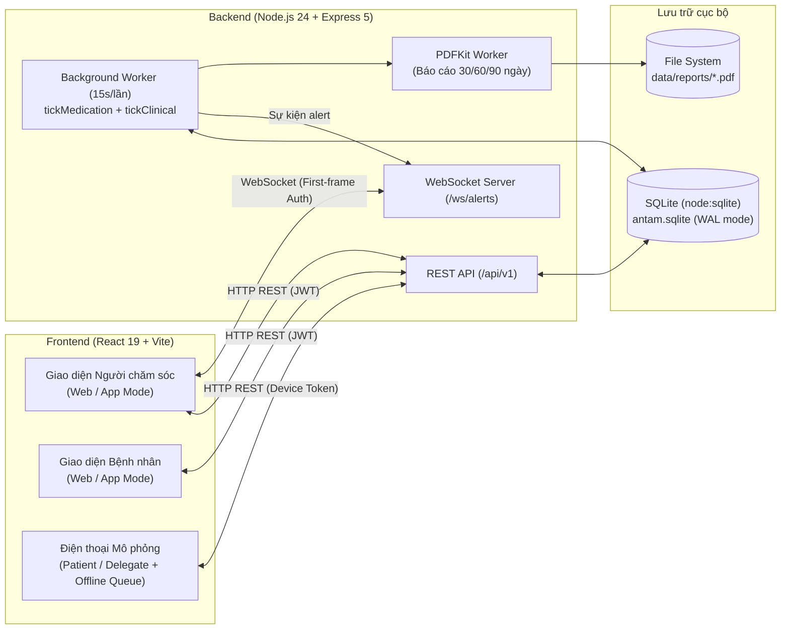
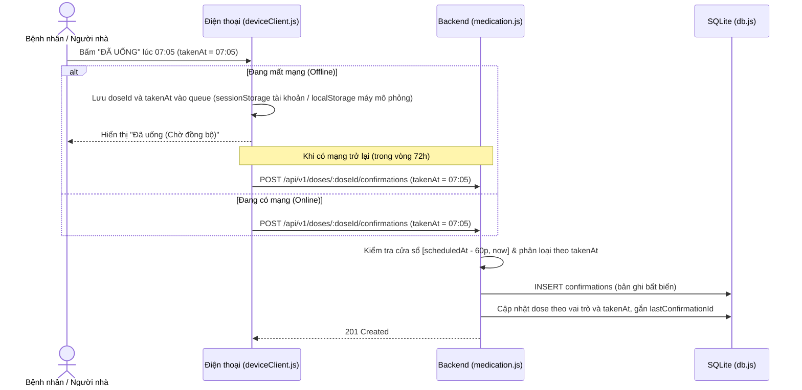
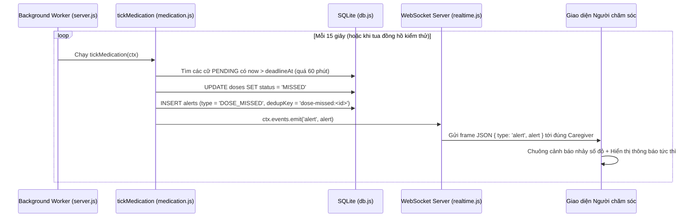

# Giải Thích Chi Tiết Mã Nguồn Dự Án An Tâm (v1.0)

Tài liệu này giải thích toàn diện kiến trúc, cấu trúc thư mục, cơ sở dữ liệu, luồng hoạt động và chi tiết từng tệp mã nguồn của hệ thống **An Tâm v1.0** — *Hệ thống hỗ trợ người chăm sóc theo dõi điều trị ngoại trú cho bệnh nhân cao tuổi mắc đái tháo đường type 2*.

Đã đối chiếu với mã nguồn ngày **15/11/2026**. Nếu mới đọc dự án, bắt đầu ở **mục 7** để biết thứ tự đọc và cách hiểu một file React, sau đó dùng **mục 8** để tìm file cần sửa. Các liên kết dùng đường dẫn tương đối để mở được khi chuyển dự án sang máy khác.

---

## Mục Lục

1. [Tổng Quan Kiến Trúc & Công Nghệ](#1-tổng-quan-kiến-trúc--công-nghệ)
2. [Cấu Trúc Thư Mục Dự Án](#2-cấu-trúc-thư-mục-dự-án)
3. [Giải Thích Chi Tiết Backend (`backend/`)](#3-giải-thích-chi-tiết-backend-backend)
   - [3.1. Khởi tạo Server & Background Worker (`server.js`, `app.js`)](#31-khởi-tạo-server--background-worker-serverjs-appjs)
   - [3.2. Cấu hình & Tiện ích dùng chung (`config.js`, `common.js`)](#32-cấu-hình--tiện-ích-dùng-chung-configjs-commonjs)
   - [3.3. Tầng Cơ sở dữ liệu SQLite & Ràng buộc bất biến (`db.js`)](#33-tầng-cơ-sở-dữ-liệu-sqlite--ràng-buộc-bất-biến-dbjs)
   - [3.4. Bảo mật, Xác thực & Phân quyền (`security.js`)](#34-bảo-mật-xác-thực--phân-quyền-securityjs)
   - [3.5. Quản lý Tài khoản, Hồ sơ & Ghép nối Thiết bị (`accounts.js`)](#35-quản-lý-tài-khoản-hồ-sơ--ghép-nối-thiết-bị-accountsjs)
   - [3.6. Nghiệp vụ Đơn thuốc, Cữ thuốc & Tuân thủ (`medication.js`)](#36-nghiệp-vụ-đơn-thuốc-cữ-thuốc--tuân-thủ-medicationjs)
   - [3.7. Xét nghiệm, Tái khám, Cảnh báo, Nhật ký & Báo cáo PDF (`clinical.js`)](#37-xét-nghiệm-tái-khám-cảnh-báo-nhật-ký--báo-cáo-pdf-clinicaljs)
   - [3.8. Cảnh báo Thời gian thực qua WebSocket (`realtime.js`)](#38-cảnh-báo-thời-gian-thực-qua-websocket-realtimejs)
   - [3.9. Danh mục thuốc, Công cụ kiểm thử & Scripts (`catalog.js`, `devtools.js`, `scripts/`)](#39-danh-mục-thuốc-công-cụ-kiểm-thử--scripts-catalogjs-devtoolsjs-scripts)
4. [Giải Thích Chi Tiết Frontend (`frontend/`)](#4-giải-thích-chi-tiết-frontend-frontend)
   - [4.1. Khởi chạy & Điều hướng (`main.jsx`, `App.jsx`, `app/router.js`)](#41-khởi-chạy--điều-hướng-mainjsx-appjsx-approuterjs)
   - [4.2. Tầng Giao tiếp API & Quản lý Token (`src/api/`)](#42-tầng-giao-tiếp-api--quản-lý-token-srcapi)
   - [4.3. Quản lý Trạng thái, Cache & Thời gian thực (`src/app/`)](#43-quản-lý-trạng-thái-cache--thời-gian-thực-srcapp)
   - [4.4. Luật Nghiệp vụ phía Giao diện (`src/domain/rules.js`)](#44-luật-nghiệp-vụ-phía-giao-diện-srcdomainrulesjs)
   - [4.5. Ứng dụng Điện thoại Mô phỏng & Offline Queue (`src/device/`)](#45-ứng-dụng-điện-thoại-mô-phỏng--offline-queue-srcdevice)
   - [4.6. Các Trang Giao diện Chính (`src/pages/` & `src/shell/`)](#46-các-trang-giao-diện-chính-srcpages--srcshell)
5. [Các Luồng Nghiệp Vụ Trọng Tâm (End-to-End Workflows)](#5-các-luồng-nghiệp-vụ-trọng-tâm-end-to-end-workflows)
6. [Các Điểm Sáng Kỹ Thuật & Thiết Kế An Toàn](#6-các-điểm-sáng-kỹ-thuật--thiết-kế-an-toàn)
7. [Cách đọc code khi mới bắt đầu](#7-cách-đọc-code-khi-mới-bắt-đầu)
8. [Muốn sửa chức năng nào thì mở file nào?](#8-muốn-sửa-chức-năng-nào-thì-mở-file-nào)
9. [Database và cách chạy dự án](#9-database-và-cách-chạy-dự-án)

---

## 1. Tổng Quan Kiến Trúc & Công Nghệ

Hệ thống **An Tâm** được thiết kế theo kiến trúc **Client–Server hợp nhất** (có thể chạy trên 1 cổng duy nhất `8080` khi đóng gói hoặc chạy tách cổng `5173` + `8080` khi phát triển):



### Công nghệ sử dụng (Tech Stack)

| Phân hệ | Công nghệ / Thư viện | Mục đích sử dụng |
| :--- | :--- | :--- |
| **Runtime** | **Node.js >= 24** | Sử dụng trực tiếp module tích hợp sẵn `node:sqlite` (`DatabaseSync`), `node:crypto`, `node:test`. |
| **Backend Web** | **Express 5** (`^5.1.0`) | Định tuyến REST API `/api/v1`, xử lý bất đồng bộ tự nhiên, phục vụ tệp tĩnh của Frontend. |
| **Validation** | **Zod** (`^4.1.0`) | Kiểm tra dữ liệu đầu vào (Body, Query, Path Params); nhiều schema dùng `.strict()` để từ chối trường dư. |
| **Bảo mật & JWT** | **jose** (`^6.1.0`) + `node:crypto` | Ký/xác thực JWT (`HS256`), băm mật khẩu (`scrypt`), băm token (`SHA-256`), mã hóa push token (`AES-256-GCM`). |
| **Realtime** | **ws** (`^8.18.0`) | Máy chủ WebSocket đẩy cảnh báo bỏ lỡ cữ thuốc và nhắc tái khám theo thời gian thực. |
| **Xuất PDF** | **pdfkit** (`^0.17.2`) | Dựng báo cáo theo dõi điều trị 30/60/90 ngày bằng tiếng Việt chuẩn định dạng trang A4. |
| **Frontend** | **React 19** + **Vite 6** | Xây dựng Single Page Application (SPA) với kiến trúc nhẹ, không phụ thuộc thư viện state nặng nề. |

Các phiên bản ở trên là khoảng phiên bản khai báo trong `backend/package.json`; phiên bản cài thực tế còn phụ thuộc lockfile. “App Mode” hiện là cách bố trí giao diện trong trình duyệt, chưa phải ứng dụng native Android/iOS. Cả bệnh nhân và người chăm sóc đều đăng nhập được ở hai cách hiển thị web/app. Backend chưa tích hợp gửi push FCM/APNs; nhắc thuốc trên điện thoại mô phỏng hoạt động khi giao diện đang chạy.

---

## 2. Cấu Trúc Thư Mục Dự Án

```text
dev/
├── AnTam.cmd                    # Script khởi chạy tự động 1-click trên Windows
├── package.json                 # Scripts điều phối chung cho cả backend & frontend
├── scripts/run.mjs              # Thực hiện các chế độ dev, start, build tại thư mục gốc
├── README.md                    # Hướng dẫn cài đặt và kịch bản kiểm thử
├── docs/                        # Tài liệu đặc tả (SRS, RTM, OpenAPI, Kiến trúc C4/DFD/UML)
├── backend/                     # Mã nguồn máy chủ Backend
│   ├── src/
│   │   ├── server.js            # Điểm vào chạy HTTP Server, WebSocket & Worker định kỳ
│   │   ├── app.js               # Khởi tạo Express app, middleware, CORS, error handler
│   │   ├── config.js            # Đọc cấu hình từ .env và quản lý khóa bảo mật local
│   │   ├── common.js            # Hằng số, lỗi ApiError, xử lý ngày giờ UTC+07, Zod helper
│   │   ├── db.js                # Kết nối SQLite, schema, indexes, transactions, triggers
│   │   ├── security.js          # Mật mã học, JWT, middlewares xác thực & phân quyền
│   │   ├── accounts.js          # API Đăng ký/Đăng nhập, Hồ sơ bệnh nhân, Người nhà, Thiết bị
│   │   ├── medication.js        # API Đơn thuốc, Sinh cữ, Xác nhận, Đính chính, Scheduler thuốc
│   │   ├── clinical.js          # API Xét nghiệm, Tái khám, Cảnh báo, Audit Log, PDF Worker
│   │   ├── realtime.js          # Máy chủ WebSocket /ws/alerts
│   │   ├── catalog.js           # Khởi tạo 21 thuốc mẫu trong danh mục hiện tại
│   │   └── devtools.js          # API tua nhanh đồng hồ máy chủ phục vụ kiểm thử
│   ├── scripts/
│   │   ├── seed.js              # Tạo dữ liệu mẫu (2 hồ sơ "Bố" & "Mẹ", 45 ngày lịch sử)
│   │   └── reset-demo.js        # Xóa DB, PDF, đồng hồ ảo và chạy lại seed
│   └── test/                    # Kiểm thử tích hợp HTTP & nghiệp vụ bằng node:test
└── frontend/                    # Mã nguồn giao diện Web App & Điện thoại mô phỏng
    ├── src/
    │   ├── main.jsx             # Điểm vào gắn React vào DOM
    │   ├── App.jsx              # Điều hướng gốc theo vai trò (Caregiver / Patient / Device)
    │   ├── api/                 # Lớp gọi HTTP REST, tự động refresh token, chuẩn hóa lỗi
    │   ├── app/                 # Context toàn cục, bộ đệm truy vấn (query cache), đồng hồ, WS
    │   ├── domain/              # Luật nghiệp vụ thuần (Bảng quyết định R1-R5, gom cữ, kiểm tra form)
    │   ├── device/              # Ứng dụng điện thoại mô phỏng & hàng đợi ngoại tuyến (Offline Queue)
    │   ├── components/          # Thành phần UI dùng chung, biểu đồ SVG, ô tìm thuốc
    │   ├── pages/               # Các màn hình chức năng và phần bảng thuốc dùng chung
    │   ├── shell/               # Khung giao diện (Sidebar, Topbar, Chuông cảnh báo, Modal hồ sơ)
    │   ├── demo/                # Bảng công cụ kiểm thử (tua giờ, giả lập mất mạng, thử xóa audit)
    │   ├── lib/                 # Hàm xử lý thời gian UTC+07 và chuẩn hóa chuỗi tiếng Việt
    │   └── styles/              # Hệ thống CSS chia theo module (tokens, base, layout, pages...)
    └── tests/                   # Kiểm thử luật nghiệp vụ & tầng API phía giao diện
```

---

## 3. Giải Thích Chi Tiết Backend (`backend/`)

### 3.1. Khởi tạo Server & Background Worker ([server.js](../backend/src/server.js), [app.js](../backend/src/app.js))

* **[server.js](../backend/src/server.js)**:
  * Gọi `createApp()` để lấy đối tượng Express `app` và ngữ cảnh ứng dụng `ctx`.
  * Gắn máy chủ WebSocket vào cùng cổng HTTP thông qua `attachRealtime(server, ctx)`.
  * Thiết lập vòng lặp **Background Worker** (`runWorker`) chạy định kỳ mỗi `schedulerIntervalMs` (mặc định 15 giây):
    1. Gọi `tickMedication(ctx)`: Chuyển trạng thái các cữ thuốc đã đến giờ (`SCHEDULED` -> `PENDING`) hoặc quá hạn 60 phút (`PENDING` -> `MISSED`), hết hạn đơn thuốc qua ngày tái khám (`ACTIVE` -> `EXPIRED`) và phát cảnh báo.
    2. Gọi `tickClinical(ctx)`: Kiểm tra lịch hẹn tái khám sắp tới để tạo cảnh báo và xử lý hàng đợi tạo file báo cáo PDF.
  * Lắng nghe sự kiện nội bộ `ctx.events.on('report-requested')` để yêu cầu chạy `runWorker` sau `200ms`. Đây là thời gian kích hoạt xử lý, không phải cam kết PDF hoàn tất trong 200ms; nếu worker đang bận, công việc còn lại được xử lý ở lượt sau.
  * Xử lý **Graceful Shutdown** khi nhận tín hiệu `SIGINT`/`SIGTERM`: dừng timer, đóng WebSocket, đợi tác vụ worker đang chạy hoàn tất rồi mới đóng kết nối SQLite.

* **[app.js](../backend/src/app.js)**:
  * Khởi tạo đối tượng ngữ cảnh **`ctx`** truyền xuyên suốt toàn bộ các module, bao gồm:
    * `ctx.db`: Kết nối cơ sở dữ liệu SQLite.
    * `ctx.config`: Cấu hình hệ thống.
    * `ctx.now()`: Hàm lấy thời gian hiện tại (hỗ trợ đồng hồ ảo khi kiểm thử).
    * `ctx.events`: `EventEmitter` kết nối giữa các route/worker và WebSocket.
    * `ctx.audit(...)`: Hàm ghi nhận nhật ký thao tác vào bảng `auditLogs`.
    * `ctx.dummyPasswordHash`: Bản băm mật khẩu giả dùng để cân bằng thời gian xử lý (chống Timing Attack khi đăng nhập bằng email không tồn tại).
  * Thiết lập các Security Headers (`X-Content-Type-Options: nosniff`, `Cache-Control: no-store`, `Referrer-Policy: no-referrer`) và kiểm soát chặt chẽ `CORS`.
  * Kiểm tra định dạng UUID cho tất cả các tham số đường dẫn (`patientId`, `prescriptionId`, `doseId`...) ngay tại tầng `router.param`.
  * **Chế độ một cổng (Single-port mode)**: Nếu thư mục `frontend/dist` đã được build, Express tự động phục vụ giao diện web qua `express.static`.
  * **Global Error Handler (middleware cuối trong `createApp`)**:
    * Chuẩn hóa mọi lỗi về cấu trúc `{ code, message, details }`.
    * Tự động bắt lỗi `UNIQUE constraint` từ SQLite để trả về HTTP `409 CONFLICT`.
    * **Tự động ghi Audit khi thất bại**: Nếu một yêu cầu thay đổi dữ liệu (`POST`, `PUT`, `PATCH`, `DELETE`) đã xác thực bị lỗi, hệ thống tự động ghi một bản ghi `FAILURE` vào `auditLogs`.

---

### 3.2. Cấu hình & Tiện ích dùng chung ([config.js](../backend/src/config.js), [common.js](../backend/src/common.js))

* **[config.js](../backend/src/config.js)**:
  * Hàm `getConfig()` đọc `process.env` và giá trị mặc định. Tệp `.env` được Node nạp qua tùy chọn `--env-file-if-exists=.env` trong lệnh khởi chạy, không được `config.js` tự đọc.
  * Quản lý khóa bí mật (`jwtSecret` tối thiểu 32 ký tự và `tokenEncryptionKey` 64 ký tự hex):
    * Ở môi trường `production`, bắt buộc phải truyền qua biến môi trường.
    * Khi chạy local, nếu chưa khai báo khóa, `getConfig()` đọc khóa đã lưu hoặc tự sinh và lưu vào `data/local-keys.json` (truyền mode `0o600` khi tạo file). Không có hàm `loadOrCreateLocalSecrets()` trong code hiện tại. Giữ khóa ổn định giúp token còn hạn tiếp tục được xác thực sau khi restart.
* **[common.js](../backend/src/common.js)**:
  * Định nghĩa các hằng số nghiệp vụ:
    * `TIME_SLOTS`: `['MORNING', 'NOON', 'AFTERNOON', 'EVENING']`
    * `DOSE_WINDOW_MINUTES = 60`: Ngưỡng đúng giờ ±60 phút quanh giờ hẹn.
    * `DOSE_STATUSES`: `['SCHEDULED', 'PENDING', 'TAKEN', 'TAKEN_BY_DELEGATE', 'LATE_CONFIRMED', 'MISSED', 'CANCELLED']`
    * `PRESCRIPTION_STATUSES`: `['DRAFT', 'ACTIVE', 'SUPERSEDED', 'EXPIRED', 'CANCELLED']`
  * Hàm `localDate(date)` và `shiftDate(dateStr, days)`: Luôn tính toán ngày nghiệp vụ theo múi giờ Việt Nam (**UTC+07**), không phụ thuộc vào múi giờ cài đặt trên máy chủ chạy Node.js.
  * Hàm `parse(schema, input)`: Chạy kiểm tra Zod schema, nếu sai sẽ ném ra `ApiError(400, 'VALIDATION_ERROR', ...)` kèm danh sách các trường bị lỗi (`details`).

---

### 3.3. Tầng Cơ sở dữ liệu SQLite & Ràng buộc bất biến ([db.js](../backend/src/db.js))

Tệp `db.js` sử dụng thư viện tích hợp sẵn `DatabaseSync` của `node:sqlite` với thiết kế lai giữa **Document Store** và **Relational Database**:

1. **Cấu trúc bảng thông minh (JSON + Virtual Generated Columns)**:
   * Hệ thống gồm 16 bảng dữ liệu ứng dụng: `caregivers`, `patients`, `patientAccounts`, `delegates`, `pairingCodes`, `devices`, `refreshTokens`, `drugs`, `prescriptions`, `doses`, `confirmations`, `alerts`, `labResults`, `appointments`, `reports`, `auditLogs`. Ngoài ra có bảng `schemaMigrations` lưu phiên bản cấu trúc database; bảng này không dùng cấu trúc `id/data` bên dưới.
   * Mỗi bảng lưu khóa chính `id TEXT PRIMARY KEY` và cột `data TEXT NOT NULL CHECK(json_valid(data))`.
   * Các bảng thuộc về bệnh nhân có thêm cột ảo tự động trích xuất từ JSON:
     ```sql
     patientId TEXT GENERATED ALWAYS AS (json_extract(data, '$.patientId')) VIRTUAL REFERENCES patients(id)
     ```
     Nhờ đó, vừa giữ được sự linh hoạt của JSON, vừa đảm bảo **Ràng buộc khóa ngoại (Foreign Key)** và đánh **Index** tốc độ cao trên `patientId`.

2. **Các Unique Index bảo vệ toàn vẹn dữ liệu ở tầng CSDL**:
   * `one_active_prescription`: Đảm bảo mỗi bệnh nhân chỉ có **tối đa 1 đơn thuốc `ACTIVE`** tại mọi thời điểm.
   * `dose_schedule`: Chống sinh trùng lặp cữ thuốc cho cùng `(prescriptionItemId, date, slot)`.
   * `one_initial_confirmation`: Mỗi cữ thuốc chỉ có **1 xác nhận gốc** (`correctsConfirmationId IS NULL`) — chặn triệt để lỗi bấm đúp (race condition).
   * `one_correction_successor`: Mỗi bản ghi xác nhận chỉ được đính chính **tối đa 1 lần**, tạo thành danh sách liên kết đơn (singly-linked list) tuyến tính, không phân nhánh.

3. **Triggers Bất biến (Append-only Immutability)**:
   * Hai bảng `confirmations` (xác nhận uống thuốc) và `auditLogs` (nhật ký hệ thống) được gắn SQLite Trigger chặn đứng mọi lệnh `UPDATE` và `DELETE`:
     ```sql
     CREATE TRIGGER immutable_confirmations_UPDATE BEFORE UPDATE ON confirmations
     BEGIN SELECT RAISE(ABORT, 'append-only record'); END;
     ```
   * Kể cả khi lập trình viên gọi nhầm `db.update()` trong mã nguồn, SQLite vẫn từ chối thực thi.

4. **Quản lý Giao dịch (`db.transaction(fn)`)**:
   * Sử dụng `BEGIN IMMEDIATE` để bắt đầu giao dịch ghi và tự động `ROLLBACK` khi có ngoại lệ. Gọi lồng nhau dùng chung giao dịch ngoài, không tạo savepoint hay giao dịch độc lập. Hàm truyền vào phải đồng bộ; không dùng `async`/`await` trong `db.transaction(fn)`.

5. **Nâng cấp cấu trúc database**: `openDatabase()` kiểm tra `schemaMigrations`. Migration 2 bổ sung `patientAccounts` cùng unique index cho email và `patientId`, cho phép database cũ có thêm tài khoản bệnh nhân mà không phải xóa dữ liệu. Một hồ sơ bệnh nhân chỉ có một tài khoản bệnh nhân.

---

### 3.4. Bảo mật, Xác thực & Phân quyền ([security.js](../backend/src/security.js))

* **Mật khẩu**: Băm bằng thuật toán `scrypt` với `salt` ngẫu nhiên 16 bytes, độ dài khóa 64 bytes. Khi kiểm tra (`verifyPassword`), dùng `timingSafeEqual` để chống tấn công đo thời gian.
* **Bảo vệ Token trên CSDL**:
  * `refreshToken`, `deviceToken` và mã ghép `pairingCode` (6 số) **không bao giờ lưu dạng rõ (plaintext)** trong DB mà chỉ lưu bản băm `SHA-256` (`hashToken`).
  * `pushToken` của thiết bị di động (dùng để gửi thông báo đẩy sau này) được mã hóa đối xứng bằng **`AES-256-GCM`** kèm `iv` 12 bytes và `authTag` xác thực.
* **Cơ chế Cấp & Xoay vòng Token (`createTokenPair`)**:
  * `accessToken`: JWT ký bằng `HS256`, thời hạn ngắn (mặc định **15 phút**), chứa `sub` (ID tài khoản) và `role` (`CAREGIVER` hoặc `PATIENT`).
  * `refreshToken`: Chuỗi ngẫu nhiên 32 bytes (`base64url`), thời hạn **30 ngày**, chỉ dùng **1 lần duy nhất** (xoay vòng token khi làm mới).
* **3 Middleware Xác thực & 1 Hàm Phân quyền gắn vào `ctx`**:
  1. `ctx.account`: Chấp nhận JWT của cả `CAREGIVER` hoặc `PATIENT` (dùng cho `/auth/me`).
  2. `ctx.caregiver`: Chỉ chấp nhận JWT có `role === 'CAREGIVER'`.
  3. `ctx.device`: Xác thực linh hoạt cho ứng dụng bệnh nhân/người nhà:
     * Nếu Bearer Token có dạng JWT (3 phần ngăn cách bởi dấu chấm `.`): xác thực là tài khoản `PATIENT` đăng nhập bằng email/mật khẩu.
     * Nếu là chuỗi Opaque Token: đối chiếu `tokenHash` trong bảng `devices`, kiểm tra thiết bị còn hoạt động (`active: true`), chưa hết hạn, và nếu là thiết bị của `DELEGATE` thì người nhà đó chưa bị hủy ủy quyền.
  4. `ctx.patientAccess(req, patientId)`: Kiểm tra hồ sơ bệnh nhân có tồn tại và có thuộc quyền quản lý của `CAREGIVER` đang đăng nhập hay không (`patient.caregiverId === req.actor.id`). Nếu không khớp, trả lỗi `403 FORBIDDEN`.

---

### 3.5. Quản lý Tài khoản, Hồ sơ & Ghép nối Thiết bị ([accounts.js](../backend/src/accounts.js))

Tệp này cài đặt các nhóm API về định danh và phân quyền gia đình:

1. **Giới hạn tần suất (`publicRateLimit`)**:
   * Chặn vét cạn mật khẩu (brute-force) và dò mã PIN 6 số theo từng địa chỉ IP + đường dẫn route (mặc định 20 yêu cầu/phút cho `/auth/*` và 10 yêu cầu/phút cho `/devices/pair`).
2. **Đăng ký & Đăng nhập (`/auth/register`, `/auth/login`, `/auth/refresh`, `/auth/me`)**:
   * **Đăng ký Người chăm sóc (`CAREGIVER`)**: Chỉ cần email, mật khẩu, tên hiển thị.
   * **Đăng ký Bệnh nhân (`PATIENT`)**: Bắt buộc phải kèm mã liên kết 6 số (`pairingCode`) do người chăm sóc vừa tạo trên hồ sơ bệnh nhân đó. Khi đăng ký thành công trong transaction, mã 6 số được đánh dấu `used: true` ngay lập tức và tài khoản bệnh nhân được gắn cứng vào `patientId` đó.
3. **Quản lý Hồ sơ Bệnh nhân (`/patients`, `/patients/:patientId`)**:
   * Tạo hồ sơ với tên gọi thân mật (`alias` như "Bố", "Mẹ"), năm sinh (`1920–2010`), và giờ nhắc mặc định cho 4 buổi (`07:00`, `11:30`, `15:00`, `19:00`).
4. **Quản lý Người nhà được ủy quyền (`/patients/:patientId/delegates`)**:
   * Thêm người nhà phụ trách hỗ trợ nhắc thuốc.
   * **Thu hồi người nhà (`DELETE .../delegates/:delegateId`)**: Trong cùng một transaction, hệ thống vừa đánh dấu người nhà `active: false`, vừa **thu hồi toàn bộ thiết bị (`devices`)** đang hoạt động của người nhà đó và **vô hiệu hóa mọi mã PIN chưa dùng** của họ.
5. **Tạo mã PIN 6 số & Ghép nối Thiết bị (`/pairing-codes`, `/devices/pair`, `/device/me`)**:
   * Sinh mã 6 chữ số ngẫu nhiên (`crypto.randomInt`), có hiệu lực trong **5 phút** (`pairingMinutes = 5`).
   * Khi điện thoại gọi `/devices/pair` với mã 6 số, server trả về `deviceToken` có hạn 90 ngày để máy lưu lại và dùng cho các lần gọi tiếp theo.

---

### 3.6. Nghiệp vụ Đơn thuốc, Cữ thuốc & Tuân thủ ([medication.js](../backend/src/medication.js))

Đây là module chứa logic nghiệp vụ cốt lõi nhất của dự án:

1. **Kiểm tra Trùng Hoạt chất (`medicationWarnings`)**:
   * Khi tạo hoặc sửa đơn thuốc nháp, hàm duyệt qua các dòng thuốc có liên kết danh mục (`drugId`), trích xuất danh sách `activeIngredients` (hoạt chất) và chuẩn hóa chữ thường tiếng Việt.
   * Nếu phát hiện $\ge 2$ thuốc trong đơn có chung hoạt chất (ví dụ: hai biệt dược khác nhau cùng chứa *Metformin*), hệ thống gắn cảnh báo `"Trùng hoạt chất: Metformin"` vào đơn thuốc nhưng **không tự ý sửa hay chặn lưu đơn** (đúng nguyên tắc an toàn y tế: quyết định cuối cùng thuộc về bác sĩ/người chăm sóc).

2. **Vòng đời Đơn thuốc (`DRAFT` $\rightarrow$ `ACTIVE` $\rightarrow$ `SUPERSEDED` / `EXPIRED`)**:
   * Đơn mới tạo luôn ở trạng thái `DRAFT` (Nháp) để người chăm sóc kiểm tra lại. Chỉ đơn `DRAFT` mới được phép sửa (`PUT`) hoặc hủy (`POST .../cancel`).
   * Khi gọi **`POST /prescriptions/:prescriptionId/confirm`**:
     * Toàn bộ quá trình diễn ra trong **1 Transaction SQLite**:
       1. Tìm đơn `ACTIVE` cũ (nếu có) của bệnh nhân $\rightarrow$ chuyển sang `SUPERSEDED` (Bị thay thế) và ghi `supersededBy`.
       2. Tìm tất cả các cữ thuốc ở trạng thái `SCHEDULED` trong tương lai (`scheduledAt > now`) của đơn cũ $\rightarrow$ chuyển sang `CANCELLED` (các cữ quá khứ đã uống hoặc bỏ lỡ vẫn giữ nguyên lịch sử).
       3. Chuyển đơn hiện tại sang `ACTIVE` và gọi `generateDoses()` để sinh lịch cữ thuốc từ `startDate` đến hết `nextVisitDate`.
       4. Nếu đơn có cảnh báo trùng hoạt chất, tạo bản ghi `Alert` loại `DUPLICATE_INGREDIENT` và phát qua WebSocket.

3. **Thuật toán Sinh Cữ Thuốc (`generateDoses`)**:
   * Với mỗi ngày từ `startDate` đến `nextVisitDate`, với mỗi thuốc trong đơn và mỗi buổi uống (`MORNING`, `NOON`, `AFTERNOON`, `EVENING`), hệ thống tạo 1 bản ghi `Dose`.
   * Giờ hẹn (`scheduledAt`) ưu tiên lấy giờ riêng của từng thuốc (`item.times[slot]`); nếu không khai báo thì lấy giờ nhắc mặc định trên hồ sơ bệnh nhân (`patient.reminderTimes`).
   * Hạn chót xác nhận đúng giờ (`deadlineAt`) luôn bằng `scheduledAt + 60 phút`.
   * Giới hạn an toàn tối đa `50.000` cữ/đơn để tránh treo máy chủ nếu nhập nhầm khoảng ngày quá xa.

4. **Bộ lập lịch Tự động (`tickMedication`)**:
   * Được gọi định kỳ mỗi 15 giây bởi Background Worker và được gọi ngay trước các API đọc dữ liệu đơn/cữ thuốc (đảm bảo dữ liệu trả về luôn phản ánh đúng thời điểm hiện tại):
     * Đơn `ACTIVE` có `nextVisitDate < today` $\rightarrow$ chuyển sang `EXPIRED`.
     * Cữ `SCHEDULED` khi `now >= scheduledAt` $\rightarrow$ chuyển sang `PENDING` (Đang chờ uống).
     * Cữ `PENDING` khi `now > deadlineAt` (quá 60 phút sau giờ hẹn) $\rightarrow$ chuyển sang `MISSED` (Bỏ lỡ), đồng thời tạo cảnh báo `DOSE_MISSED` (có `dedupKey: "dose-missed:<doseId>"` đảm bảo mỗi cữ bỏ lỡ chỉ phát cảnh báo **đúng 1 lần duy nhất**).

5. **Xác nhận Uống thuốc & Chuỗi Đính chính Bất biến (`POST /doses/:doseId/confirmations`)**:
   * Kiểm tra khung thời gian nghiêm ngặt:
     * Không cho phép xác nhận sớm hơn `60 phút` trước giờ hẹn (`takenAt < scheduledAt - 60 phút`) hoặc thời điểm ở tương lai (`takenAt > now`).
     * Nếu xác nhận muộn ngoài cửa sổ ±60 phút, chỉ cho phép ghi nhận thời điểm uống nằm trong cùng ngày của cữ thuốc đó.
     * Hỗ trợ đồng bộ ngoại tuyến (Offline Sync) cho các xác nhận lưu tạm trên điện thoại trong vòng tối đa **72 giờ**.
   * **Phân loại trạng thái tự động**:
     * Nếu `takenAt <= scheduledAt + 60 phút`:
       * Người thực hiện là `PATIENT` $\rightarrow$ `TAKEN` (Đã uống đúng giờ).
       * Người thực hiện là `DELEGATE` $\rightarrow$ `TAKEN_BY_DELEGATE` (Người nhà xác nhận hộ).
     * Nếu `takenAt > scheduledAt + 60 phút` $\rightarrow$ `LATE_CONFIRMED` (Xác nhận muộn).
   * **Đính chính (`POST /doses/:doseId/corrections`, `correctsConfirmationId`)**: Chỉ CAREGIVER quản lý hồ sơ được thực hiện ở Lịch cữ thuốc → lịch sử từng thuốc → Đính chính giờ uống. PATIENT và DELEGATE bị từ chối. Bản ghi mới có actorRole CAREGIVER và actorId của người sửa, giữ bản gốc. Trạng thái đúng giờ vẫn phân biệt người tự xác nhận/người nhà xác nhận hộ từ bản gốc.
     * Không sửa bản ghi cũ. Hệ thống kiểm tra `correctsConfirmationId` phải khớp với `dose.lastConfirmationId` hiện tại, sau đó chèn một bản ghi `Confirmation` mới nối vào bản ghi trước và cập nhật `lastConfirmationId` trên `Dose`.
     * Mọi yêu cầu `PATCH` hoặc `DELETE` vào `/confirmations/:id` đều bị chặn và trả về HTTP `405 CONFIRMATION_IMMUTABLE`.

6. **Tính toán Tỷ lệ Tuân thủ (`adherence`)**:
   * Công thức tính trong khoảng 7, 30 hoặc 90 ngày gần nhất:
     $$\text{Tỷ lệ tuân thủ} = \frac{\text{TAKEN} + \text{TAKEN\_BY\_DELEGATE} (+ \text{LATE\_CONFIRMED nếu bật cấu hình})}{\text{TAKEN} + \text{TAKEN\_BY\_DELEGATE} + \text{LATE\_CONFIRMED} + \text{MISSED}}$$
   * Các cữ chưa đến giờ (`SCHEDULED`), đang chờ trong hạn (`PENDING`) hoặc đã hủy (`CANCELLED`) không đưa vào mẫu số.

---

### 3.7. Xét nghiệm, Tái khám, Cảnh báo, Nhật ký & Báo cáo PDF ([clinical.js](../backend/src/clinical.js))

* **Xét nghiệm (`/lab-results`)**: Lưu các chỉ số `HBA1C`, `FASTING_GLUCOSE` (Đường huyết lúc đói), `POSTPRANDIAL_GLUCOSE` (Đường huyết sau ăn) và `OTHER`. Chặn nhập ngày xét nghiệm ở tương lai.
* **Lịch hẹn tái khám (`/appointments`)**: Lưu ngày hẹn khám và số ngày nhắc trước (`remindDaysBefore`, mặc định 2 ngày).
* **Cảnh báo (`/alerts`)**: Hỗ trợ lọc cảnh báo chưa đọc (`unreadOnly=true`), đánh dấu đã đọc từng cảnh báo (`PATCH /alerts/:alertId/read`) hoặc đánh dấu đọc hàng loạt (`POST /patients/:patientId/alerts/read`).
* **Nhật ký kiểm toán (`/audit-logs`)**:
  * Hỗ trợ phân trang (`page`, `size`) và lọc đa tiêu chí theo `actionType`, `actorRole`, `status`, từ khóa `q`.
  * Hàm `auditActor()` tự động tra cứu tên hiển thị của người thực hiện từ `caregivers`, `devices`, `patientAccounts` hoặc gán nhãn `"Hệ thống"` nếu `userId === SYSTEM_ID`.
  * Các phương thức `POST`, `PUT`, `PATCH`, `DELETE` vào `/patients/:patientId/audit-logs` hoặc `/patients/:patientId/audit-logs/:logId`, sau khi qua kiểm tra quyền, bị chặn bởi hàm `immutable`. Hệ thống ghi hành vi can thiệp (`AUDIT_LOG_MUTATION_BLOCKED`) và trả HTTP `405`.
* **Dựng Báo cáo PDF Bất đồng bộ (`createPdf` & `tickClinical`)**:
  * Khi người chăm sóc yêu cầu tạo báo cáo (`POST /patients/:patientId/reports`), server tạo bản ghi trạng thái `QUEUED` và trả về ngay HTTP `202 Accepted`.
  * Worker `tickClinical` lấy tối đa 3 báo cáo `QUEUED`/`PROCESSING` mỗi lượt, dùng thư viện `PDFKit` với font Unicode tiếng Việt (`Arial` trên Windows / `DejaVuSans` trên Linux) để vẽ báo cáo gồm 5 mục:
    1. Tổng hợp tỷ lệ tuân thủ.
    2. Đơn thuốc đang hiệu lực.
    3. Kết quả xét nghiệm trong kỳ.
    4. Lịch tái khám sắp tới.
    5. Danh sách chi tiết các cữ bỏ lỡ hoặc xác nhận muộn.
  * **Ghi tệp nguyên tử (Atomic File Write)**: PDF được ghi ra tệp tạm `<reportId>.pdf.tmp` trước; chỉ khi kết xuất hoàn tất toàn bộ trang và đánh số trang chân trang xong mới đổi tên (`rename`) thành `<reportId>.pdf` và chuyển trạng thái sang `READY`. Nếu xảy ra lỗi giữa chừng, tệp `.tmp` được dọn sạch và báo cáo chuyển sang `FAILED`.

---

### 3.8. Cảnh báo Thời gian thực qua WebSocket ([realtime.js](../backend/src/realtime.js))

* Lắng nghe sự kiện nâng cấp kết nối HTTP (`upgrade`) tại đường dẫn `/ws/alerts`.
* **Xác thực qua khung tin đầu tiên (First-frame Authentication)**:
  * Thay vì truyền JWT trên thanh địa chỉ URL (`?token=...`) dễ bị lộ trong log máy chủ hoặc lịch sử trình duyệt, kết nối WebSocket khi mới mở sẽ ở trạng thái chưa xác thực và đặt bộ đếm ngược **5 giây**.
  * Trình duyệt phải gửi gói tin đầu tiên: `{ "type": "authenticate", "token": "<JWT>" }`.
  * Server xác thực JWT, gắn `ws.actor` và phản hồi `{ "type": "authenticated" }`. Nếu quá 5 giây hoặc token sai, kết nối bị đóng ngay với mã `4401`.
* **Phát cảnh báo đúng chủ sở hữu (`broadcast`)**:
  * Khi `ctx.events` phát sự kiện `'alert'`, server tra cứu `caregiverId` của bệnh nhân liên quan và chỉ gửi gói tin tới các kết nối WebSocket của đúng người chăm sóc đó (đồng thời kiểm tra token trên kết nối đó chưa hết hạn).
* **Heartbeat 30 giây**: Định kỳ gửi `ping()` mỗi 30 giây để dọn dẹp các kết nối đã đứt mạng ngầm và ngắt các phiên có JWT đã hết hạn.

---

### 3.9. Danh mục thuốc, Công cụ kiểm thử & Scripts ([catalog.js](../backend/src/catalog.js), [devtools.js](../backend/src/devtools.js), `scripts/`)

* **[catalog.js](../backend/src/catalog.js)**: Mảng `DEMO_DRUGS` hiện có **21 thuốc mẫu**, gồm 5 phần tử đầu và 16 phần tử tạo bằng `.map()`. Ví dụ: `Glucophage 500mg`, `Panfor SR 500mg`, `Diamicron MR 30mg`, `Jardiance 10mg`, `Janumet 50mg/500mg`. Đây là dữ liệu minh họa của dự án, không phải danh mục thuốc chính thức. `seedCatalog(ctx)` chạy khi khởi tạo ứng dụng và chỉ chèn ID chưa tồn tại; sửa nội dung của ID đã có trong file không cập nhật bản ghi cũ trong database.
* **[devtools.js](../backend/src/devtools.js)**:
  * Khi bật `ENABLE_DEV_TOOLS=true` và không chạy ở `production`, cung cấp endpoint `GET/POST /api/v1/dev/clock` cho người chăm sóc. Body nhận đúng một trong hai trường `advanceMinutes` hoặc `to` (chuỗi thời điểm ISO), không có trường `setTime`. Mỗi lần tua tối đa 14 ngày.
  * Độ lệch thời gian (`offsetMs`) được lưu vào `data/dev-clock.json`. Đồng hồ chỉ cho phép tua tiến (không tua lùi) để đảm bảo tính nhất quán dòng thời gian của dữ liệu đã sinh.
* **[scripts/seed.js](../backend/scripts/seed.js)** & **[scripts/reset-demo.js](../backend/scripts/reset-demo.js)**:
  * `seed.js` tạo tài khoản demo, 2 hồ sơ bệnh nhân ("Bố" và "Mẹ"), 45 ngày lịch sử uống thuốc, chỉ số xét nghiệm, lịch tái khám và đơn nháp trùng hoạt chất. Email/mật khẩu có thể đặt bằng `DEMO_EMAIL`/`DEMO_PASSWORD`; nếu không đặt mật khẩu, script sinh ngẫu nhiên và in ra terminal. `AnTam@2026` là cấu hình chạy thử, không phải mật khẩu cố định bên trong `seed.js`.
  * `seed.js` không ghi đè tài khoản demo đã có. `reset-demo.js` xóa database, PDF và đồng hồ kiểm thử rồi tạo lại dữ liệu mẫu; không dùng lệnh reset để cập nhật code thông thường.

---

## 4. Giải Thích Chi Tiết Frontend (`frontend/`)

### 4.1. Khởi chạy & Điều hướng ([main.jsx](../frontend/src/main.jsx), [App.jsx](../frontend/src/App.jsx), [app/router.js](../frontend/src/app/router.js))

* **[main.jsx](../frontend/src/main.jsx)**: Điểm bắt đầu của React. Import các file CSS, tìm phần tử `#root` trong `frontend/index.html`, rồi dùng `createRoot(...).render(<StrictMode><App /></StrictMode>)` để gắn ứng dụng vào trang. `StrictMode` giúp phát hiện một số vấn đề khi phát triển; effect có thể chạy thêm một lượt kiểm tra ở chế độ dev.

* **[app/router.js](../frontend/src/app/router.js)**:
  * Cài đặt bộ định tuyến dựa trên URL Hash (`window.location.hash`, ví dụ `#/tong-quan`, `#/don-thuoc/moi`, `#/thiet-bi?surface=app`).
  * Việc dùng Hash Router giúp Backend chỉ cần phục vụ duy nhất tệp `index.html` mà không cần cấu hình rewrite phức tạp.
* **[App.jsx](../frontend/src/App.jsx)**:
  * Thành phần gốc `Root()` phân nhánh luồng giao diện dựa trên trạng thái đăng nhập và vai trò:
    1. Nếu đường dẫn là `#/thiet-bi` và có `pairing=1` hoặc tham số `phone`: Hiển thị giao diện điện thoại mô phỏng độc lập (`DeviceStandalone`). Tham số `phone` trên đường dẫn khác không bật màn hình này.
    2. Nếu chưa đăng nhập (`!session`): Hiển thị trang Đăng nhập / Đăng ký (`AuthPage`).
    3. Nếu đăng nhập với vai trò `PATIENT`: Hiển thị màn hình dành riêng cho bệnh nhân (`PatientPage`) — chữ to, thao tác tối giản, chỉ xem và xác nhận cữ thuốc của chính mình.
    4. Nếu đăng nhập với vai trò `CAREGIVER`: Hiển thị khung quản lý `AppShell` kèm các trang chức năng (`CaregiverRoutes`).

---

### 4.2. Tầng Giao tiếp API & Quản lý Token ([src/api/](../frontend/src/api/http.js))

* **[api/http.js](../frontend/src/api/http.js)**:
  * Lưu cặp `accessToken`, `refreshToken`, `role` và `accountId` trong `sessionStorage` của tab. Tải lại trang vẫn giữ phiên; bấm Đăng xuất gọi `clearSession()` để xóa phiên phía trình duyệt. Không có endpoint thu hồi toàn bộ JWT khi đăng xuất; token đã cấp vẫn chịu thời hạn và kiểm tra quyền phía server.
  * **Cơ chế Tự động Refresh Token thông minh**:
    * Khi một lời gọi API trả về `401` và đang có `refreshToken`, hàm `refreshTokens()` sẽ tự động gọi `POST /api/v1/auth/refresh`.
    * Sử dụng biến khóa `refreshing` (Singleton Promise): Nếu trên trang có 5 API cùng hết hạn một lúc, chỉ có **1 yêu cầu `/auth/refresh` duy nhất** được gửi đi; cả 5 API cùng đợi kết quả mới rồi tự động gửi lại yêu cầu ban đầu.
    * Biến đếm `sessionGeneration`: Kiểm tra phiên trước/sau các lần gửi request và refresh để yêu cầu của phiên cũ không được gửi lại bằng token của tài khoản mới. Đây là kiểm tra ở phía client, không hủy thao tác mà server đã nhận và xử lý.
* **[api/caregiver.js](../frontend/src/api/caregiver.js)** & **[api/device.js](../frontend/src/api/device.js)**: Đóng gói các lời gọi API thành hàm dễ dùng. Dù tên là `caregiver.js`, các hàm `register`, `login`, `getMe` ở đây dùng cho cả hai vai trò. `device.js` dùng token thiết bị hoặc phiên JWT bệnh nhân thông qua dấu hiệu `ACCOUNT_SESSION`; dấu hiệu này không phải token gửi lên server.
* **[api/errors.js](../frontend/src/api/errors.js)**: Việt hóa các thông báo lỗi kỹ thuật và chuẩn hóa tên trường lỗi để hiển thị trực tiếp cạnh từng ô nhập liệu trên form.

---

### 4.3. Quản lý Trạng thái, Cache & Thời gian thực ([src/app/](../frontend/src/app/AppContext.jsx))

* **[app/query.js](../frontend/src/app/query.js)**:
  * Một thư viện Data Fetching & Caching gọn nhẹ tự viết (tương tự React Query / SWR) thông qua hook `useQuery(key, fetcher, options)`.
  * Lưu dữ liệu theo khóa phân cấp `p:<patientId>:<tên_tài_nguyên>`.
  * Khi có thao tác ghi dữ liệu, chỉ cần gọi `invalidate(patientKey(patient.id))` là toàn bộ các bảng dữ liệu thuộc bệnh nhân đó trên màn hình tự động tải mới.
* **[app/AppContext.jsx](../frontend/src/app/AppContext.jsx)**:
  * Quản lý trạng thái toàn cục: tài khoản đang đăng nhập (biến còn mang tên `caregiver`, nhưng có thể chứa tài khoản PATIENT), danh sách bệnh nhân (`patients`), bệnh nhân đang chọn (`patient`), thông báo nổi (`toasts`), khung điện thoại (`phoneOpen`) và chế độ chú thích (`annotate`). Chỉ tải danh sách hồ sơ quản lý khi phiên không phải PATIENT. Khi đăng xuất/đổi tài khoản, xóa cache truy vấn và dữ liệu điện thoại của phiên tài khoản.
  * Cung cấp hàm tiện ích `call(fn, { success, errorTitle, refresh })`: Bọc mọi lời gọi API thay đổi dữ liệu, tự động bắt lỗi để bật Toast cảnh báo và tự động gọi `invalidate(refresh)`.
* **[app/realtime.js](../frontend/src/app/realtime.js)**:
  * Mở kết nối WebSocket tới `/ws/alerts`, gửi gói tin xác thực `{ type: 'authenticate', token }` ngay khi `onopen`.
  * Khi nhận `{ type: 'alert', alert }`, gọi callback `onAlert`; `AppShell.jsx` làm mới dữ liệu và hiện toast. Âm nhắc thuốc nằm ở `deviceClient.js`/`DeviceApp.jsx`, không phải chức năng của hook WebSocket này. Hook tự thử kết nối lại với độ trễ tăng dần khi mất kết nối.
* **[app/clock.js](../frontend/src/app/clock.js)**:
  * Đồng bộ độ lệch thời gian giữa trình duyệt và máy chủ qua `/health`, giúp toàn bộ giao diện hiển thị đúng "Giờ máy chủ" (kể cả khi đang tua nhanh thời gian trong lúc kiểm thử).

---

### 4.4. Luật Nghiệp vụ phía Giao diện ([src/domain/rules.js](../frontend/src/domain/rules.js))

Tệp `rules.js` chứa các hàm thuần phục vụ kiểm tra trước và xem trước trên giao diện. Chúng được viết để bám theo Backend, nhưng Backend vẫn là nơi quyết định dữ liệu hợp lệ và quyền truy cập; sửa luật nghiệp vụ cần kiểm tra cả hai phía:

* `DECISION_TABLE`, `decideConfirmedStatus`, `decideUnconfirmedStatus`: Mô tả và tính trạng thái theo **Bảng quyết định R1–R5**, kết hợp chính sách thời gian hiện tại trong code.
* `checkConfirmable(dose, { takenAt, nowMs, correction })`: Kiểm tra trước xem một cữ thuốc có đủ điều kiện xác nhận/đính chính hay không (nằm trong cửa sổ từ 60 phút trước giờ hẹn đến hiện tại, không thuộc ngày khác nếu quá hạn...).
* `detectDuplicateIngredients(items, drugs)`: Phát hiện tức thì trên màn hình nhập đơn nếu người chăm sóc chọn 2 thuốc có cùng hoạt chất.
* `planDoses({ prescription, patient })` & `dosesToCancelOnSupersede(...)`: Tính toán và cho người chăm sóc **xem trước (Preview)** chính xác có bao nhiêu cữ thuốc mới sẽ được sinh ra và bao nhiêu cữ thuốc của đơn cũ sẽ bị hủy trước khi bấm nút "Xác nhận kích hoạt đơn".
* `groupDoses(doses)`: Gom thuốc cùng bệnh nhân, ngày, buổi và `scheduledAt` thành một thẻ. Hai thuốc cùng buổi nhưng giờ tự chọn khác nhau không bị gom chung. Bấm một lần trên thẻ sẽ gửi một xác nhận cho từng dose; có thể thành công một phần và báo lỗi riêng cho những thuốc còn lại.

---

### 4.5. Ứng dụng Điện thoại Mô phỏng & Offline Queue ([src/device/](../frontend/src/device/deviceClient.js))

Được thiết kế để mô phỏng sát thực tế một ứng dụng di động chạy trên máy của Bệnh nhân hoặc Người nhà:

* **[device/phones.js](../frontend/src/device/phones.js)**:
  * Điện thoại mô phỏng (`phone-1`, `phone-2`...) lưu trong `localStorage` với khóa `antam.v1.phones`. Tên trường thực tế là `token`, `online`, `cache`, `queue`, `acked` và `largeText`.
  * Điện thoại của tài khoản bệnh nhân (`account-<id>`) được tạo qua `ensureAccountPhone()` và lưu riêng trong `sessionStorage`, khóa `antam.v1.accountPhones`. `clearAccountPhones()` xóa phần này khi đăng xuất/đổi tài khoản, giữ lại các máy mô phỏng. `PatientPage.jsx` hỏi xác nhận nếu đăng xuất khi còn dữ liệu chưa gửi.
* **[device/deviceClient.js](../frontend/src/device/deviceClient.js)**:
  * **Lưu xác nhận ngoại tuyến (`confirmDoses`)**:
    * Nếu `phone.online === false`, lưu xác nhận kèm `takenAt` vào `queue`. `PatientPage.jsx` nghe sự kiện online/offline của trình duyệt; máy mô phỏng có công tắc đổi trạng thái.
    * `applyQueue()` trong **`DeviceApp.jsx`** ghép dữ liệu đang chờ gửi vào lịch hiển thị, tạo trạng thái giao diện `QUEUED` (không phải trạng thái dose lưu ở backend).
    * `setOnline(phone, true)` gọi `syncQueue(phone.id)` để gửi tuần tự hàng đợi. Server xét `takenAt` và các điều kiện xác nhận, nên xác nhận đúng giờ được đồng bộ hợp lệ vẫn có thể tính đúng giờ. Khi đồng bộ lỗi mạng, phần chưa gửi được giữ lại.
    * **Giới hạn hiện tại:** nếu `phone.online` vẫn là `true` nhưng request bị lỗi mạng hoặc server tắt, `confirmDoses()` trả lỗi để giao diện yêu cầu thử lại; không tự chuyển lần bấm đó vào queue. Không nên hiểu mọi lỗi mạng đều được tự lưu ngoại tuyến.
* **[device/DeviceApp.jsx](../frontend/src/device/DeviceApp.jsx)**:
  * Dùng hook `usePhoneData()` trong `deviceClient.js` để tải hồ sơ, lịch hôm nay và lần uống gần nhất mỗi 10 giây khi máy ở trạng thái online. Hiển thị nhắc thuốc và nút bấm lớn khi đến giờ; âm thanh còn phụ thuộc việc trình duyệt cho phép phát âm thanh.

---

### 4.6. Các Trang Giao diện Chính (`src/pages/` & `src/shell/`)

| Tệp mã nguồn | Màn hình / Chức năng |
| :--- | :--- |
| `shell/AppShell.jsx` | Khung bố cục chính của Người chăm sóc: Thanh bên (Sidebar), Bộ chuyển đổi hồ sơ bệnh nhân, Chuông cảnh báo WebSocket, Nút bật/tắt khung Điện thoại mô phỏng và Chế độ chú thích (Annotate). |
| `pages/AuthPage.jsx` | Đăng nhập / Đăng ký cho cả Người chăm sóc và Bệnh nhân (có nhập mã liên kết 6 số khi đăng ký tài khoản Bệnh nhân và nút "Điền sẵn" tài khoản demo). |
| `pages/PatientPage.jsx` | Giao diện dành riêng khi đăng nhập bằng tài khoản Bệnh nhân: xem lịch thuốc hôm nay, xác nhận đã uống theo thời điểm bấm và hỗ trợ lưu tạm khi mất mạng; không được chọn lại giờ hoặc đính chính. |
| `pages/OverviewPage.jsx` | Bảng điều khiển tổng quan: Tỷ lệ tuân thủ 7/30/90 ngày, biểu đồ cột theo ngày, cảnh báo cần chú ý, lịch cữ thuốc hôm nay và tóm tắt đơn thuốc đang dùng. |
| `pages/DosesPage.jsx` | Tra cứu lịch cữ thuốc theo khoảng ngày và trạng thái; xem chuỗi xác nhận & đính chính của từng dose (mỗi dòng thuốc tại một giờ hẹn, không phải từng viên). |
| `pages/PrescriptionsPage.jsx` | Danh sách đơn thuốc theo trạng thái (`ACTIVE`, `DRAFT`, `SUPERSEDED`, `EXPIRED`, `CANCELLED`). |
| `pages/PrescriptionEditorPage.jsx` | Form nhập/sửa đơn thuốc nháp: tìm kiếm thuốc gợi ý (`DrugAutocomplete`), chọn buổi & giờ uống riêng cho từng thuốc, cảnh báo trùng hoạt chất trực tiếp. |
| `pages/PrescriptionDetailPage.jsx` | Xem chi tiết đơn, ô đánh dấu đã kiểm tra với bác sĩ/dược sĩ khi trùng hoạt chất, xem trước số cữ sinh/hủy và nút Xác nhận đơn; có hộp thoại xác nhận khi thay đơn đang dùng. |
| `pages/ClinicalPage.jsx` | Quản lý kết quả xét nghiệm (`HbA1c`, `Glucose`), biểu đồ xu hướng chỉ số và quản lý lịch hẹn tái khám. |
| `pages/ReportsPage.jsx` & `ReportViewPage.jsx` | Yêu cầu tạo báo cáo PDF 30/60/90 ngày, theo dõi tiến trình xử lý (`QUEUED` -> `READY`) và xem/tải tệp PDF trực tiếp. |
| `pages/AuditPage.jsx` | Tra cứu nhật ký thao tác bất biến (Audit Logs) với bộ lọc theo hành động, vai trò, trạng thái và từ khóa. |
| `pages/FamilyPage.jsx` | Quản lý thông tin hồ sơ bệnh nhân, giờ nhắc mặc định, thêm/hủy người nhà được ủy quyền, tạo mã PIN 6 số và quản lý/thu hồi thiết bị đã ghép nối. |
| `demo/DemoPanel.jsx` | Hộp công cụ kiểm thử nhanh (góc trái dưới): Tua nhanh đồng hồ tới cữ thuốc kế tiếp, cho cữ quá hạn để kích hoạt cảnh báo bỏ lỡ, hoặc thử gửi lệnh xóa Audit Log để kiểm tra lỗi `405`. |

---

## 5. Các Luồng Nghiệp Vụ Trọng Tâm (End-to-End Workflows)

### Luồng 1: Nhập đơn thuốc, kiểm tra trùng hoạt chất & kích hoạt sinh cữ

```mermaid
sequenceDiagram
    actor CG as Người chăm sóc
    participant UI as Frontend (PrescriptionEditor / Detail)
    participant API as Backend (medication.js)
    participant DB as SQLite (db.js)

    CG->>UI: Nhập thông tin đơn & các dòng thuốc
    UI->>UI: detectDuplicateIngredients() cảnh báo tức thì trên form
    CG->>UI: Bấm "Lưu đơn nháp"
    UI->>API: POST /api/v1/patients/:id/prescriptions
    API->>API: medicationWarnings() kiểm tra trùng hoạt chất
    API->>DB: INSERT prescriptions (status = 'DRAFT', warnings)
    API-->>UI: 201 Created (Đơn nháp)

    CG->>UI: Xem trước số cữ sinh/hủy (planDoses) & bấm "Kích hoạt đơn"
    UI->>API: POST /api/v1/prescriptions/:id/confirm
    API->>DB: BEGIN IMMEDIATE TRANSACTION
    API->>DB: Đơn ACTIVE cũ -> SUPERSEDED; Cữ tương lai đơn cũ -> CANCELLED
    API->>DB: Đơn hiện tại -> ACTIVE
    API->>DB: generateDoses() sinh toàn bộ cữ từ startDate đến nextVisitDate
    API->>DB: Tạo Alert nếu có trùng hoạt chất + Ghi AuditLog
    API->>DB: COMMIT
    API-->>UI: 202 Accepted
```

### Luồng 2: Xác nhận uống thuốc (Online / Offline) & Đính chính bất biến



### Luồng 3: Tự động phát hiện bỏ lỡ & Đẩy cảnh báo qua WebSocket



---

## 6. Các Điểm Sáng Kỹ Thuật & Thiết Kế An Toàn

1. **Bảo vệ lịch sử xác nhận và nhật ký bằng cơ chế append-only**:
   * Dữ liệu xác nhận uống thuốc (`confirmations`) và nhật ký kiểm toán (`auditLogs`) được bảo vệ ở **cả 2 tầng**: tầng API (trả về `405 Method Not Allowed`) và tầng CSDL (SQLite Triggers `BEFORE UPDATE` / `BEFORE DELETE` ném lỗi `ABORT`).
   * Việc đính chính giờ uống được thiết kế dưới dạng danh sách liên kết đơn (`correctsConfirmationId`) kèm Unique Partial Index, giúp truy vết đầy đủ từ lần xác nhận đầu tiên đến mọi lần đính chính về sau.

2. **Chống Xung đột & Race Condition bằng Ràng buộc CSDL**:
   * Sử dụng `BEGIN IMMEDIATE` transaction kết hợp với các `UNIQUE INDEX` có điều kiện (`WHERE status = 'ACTIVE'`, `WHERE correctsConfirmationId IS NULL`) đảm bảo ngay cả khi có nhiều yêu cầu đồng thời, hệ thống không bao giờ có 2 đơn thuốc cùng `ACTIVE` hoặc 2 xác nhận gốc cho cùng 1 cữ thuốc.

3. **Xử lý Múi giờ Chuẩn xác (`UTC+07`)**:
   * Các timestamp như `scheduledAt`, `createdAt` được sinh ở dạng ISO UTC. Các trường chỉ ngày như `startDate`, `nextVisitDate`, `testedDate` dùng `YYYY-MM-DD`; giờ tự chọn dùng `HH:mm`. Hàm ngày nghiệp vụ quy chiếu về `UTC+07` để không phụ thuộc múi giờ mặc định của máy.

4. **Dùng module tích hợp của Node.js**:
   * Backend dùng `node:sqlite`, `node:crypto`, `node:test`, `node:events` của Node.js 24. SQLite lưu dữ liệu trong file nên không cần chạy một dịch vụ database riêng khi phát triển local; dự án vẫn dùng các thư viện ngoài đã liệt kê ở mục 1.

---

## 7. Cách đọc code khi mới bắt đầu

### 7.1. Vì sao mỗi file có hàng trăm dòng?

Một màn hình thường gồm nhiều phần: dữ liệu đang nhập, gọi API, xử lý đang tải/lỗi, sự kiện bấm nút, hộp thoại xác nhận và phần giao diện JSX. Ví dụ `PrescriptionEditorPage.jsx` vừa quản lý form nhiều dòng thuốc, vừa lưu bản nhập dở, kiểm tra dữ liệu và dựng từng ô nhập. File dài không có nghĩa mọi dòng đều là một thuật toán khó; nhiều dòng chỉ mô tả giao diện.

Frontend là code chạy trong trình duyệt. Backend là code Node.js chạy ở terminal. Hai phần giao tiếp qua HTTP; frontend không import `backend/src/db.js` để mở SQLite trực tiếp.

| Khái niệm | Hiểu trong dự án này |
| :--- | :--- |
| Component | Một hàm React tạo phần giao diện, như `AuthPage`, `Card`, `Field`. |
| JSX (`.jsx`) | Cú pháp mô tả giao diện trong JavaScript, trông gần giống HTML. `{...}` chèn giá trị/biểu thức JavaScript. |
| Props | Dữ liệu truyền từ component cha xuống con, như `<PatientPage account={caregiver} />`. |
| State / `useState` | Dữ liệu thay đổi trong màn hình, như nội dung form hoặc cờ đang lưu. Gọi hàm `set...` để yêu cầu cập nhật giao diện. |
| Hook | Hàm React bắt đầu bằng `use...`, dùng để kết nối state, effect hoặc dữ liệu dùng chung. |
| `useEffect` | Chạy công việc khi component xuất hiện hoặc dependency đổi, như đăng ký sự kiện hay tạo timer; có thể trả về hàm dọn dẹp. |
| `useMemo` / `useCallback` | Giữ kết quả tính toán hoặc tham chiếu hàm giữa các lần render khi dependency không đổi. |
| `useRef` | Giữ một giá trị/tham chiếu qua nhiều lần render; thay `.current` không tự yêu cầu render lại. |
| Context / `useApp()` | Lấy dữ liệu chung như tài khoản, bệnh nhân đang chọn, toast và hàm gọi API. |
| Route / endpoint | Route frontend chọn màn hình (`#/don-thuoc`); endpoint backend nhận yêu cầu dữ liệu (`/api/v1/patients/:id/prescriptions`). |
| Middleware | Bước backend chạy trước hàm xử lý chính, ví dụ `ctx.caregiver` kiểm tra người gọi đã đăng nhập đúng vai trò. |
| Cache | Bản dữ liệu giữ tạm để hiển thị/tái sử dụng. `invalidate()` báo cache cần tải lại, không xóa dữ liệu trong database. |
| Transaction | Một nhóm thao tác database cùng thành công hoặc cùng được hoàn tác khi lỗi. |

### 7.2. Thứ tự đọc đề xuất

1. Đọc [main.jsx](../frontend/src/main.jsx) để thấy ứng dụng bắt đầu ở đâu.
2. Đọc [App.jsx](../frontend/src/App.jsx), tập trung `Root()` và `CaregiverRoutes()` để biết cách chọn màn hình theo phiên/vai trò/URL.
3. Chọn một màn hình đang thấy trên web, ví dụ [AuthPage.jsx](../frontend/src/pages/AuthPage.jsx). Đọc khối `return (...)` trước để nhận ra các nút và ô nhập; sau đó tìm `onClick`, `onSubmit` rồi lần lên hàm xử lý.
4. Theo lời gọi sang [api/caregiver.js](../frontend/src/api/caregiver.js), rồi [api/http.js](../frontend/src/api/http.js) để biết endpoint, body và token được gửi thế nào.
5. Tìm endpoint tương ứng ở [accounts.js](../backend/src/accounts.js), [medication.js](../backend/src/medication.js) hoặc [clinical.js](../backend/src/clinical.js).
6. Cuối cùng đọc [db.js](../backend/src/db.js) để hiểu `get`, `list`, `insert`, `update`, `transaction`. Khi cần hiểu cách server khởi động, quay về [server.js](../backend/src/server.js) và [app.js](../backend/src/app.js).

Không cần đọc hết `medication.js` từ đầu trước khi sửa một dòng chữ trên giao diện. Với một chức năng, chỉ lần theo các hàm và dữ liệu liên quan.

### 7.3. Ví dụ lần theo nút “Lưu nháp và xem lại”

```text
PrescriptionEditorPage.jsx: người dùng nhập form và bấm lưu
  → kiểm tra form; gọi api.createPrescription(patient.id, form)
api/caregiver.js: toPrescriptionInput(form) chọn đúng trường gửi lên
  → request('/patients/<id>/prescriptions', { method: 'POST', body })
api/http.js: thêm /api/v1, token và chuyển body thành JSON
  → HTTP POST /api/v1/patients/<id>/prescriptions
backend/src/app.js: chuyển yêu cầu vào router
  → security.js: xác thực CAREGIVER
backend/src/medication.js: kiểm tra quyền trên hồ sơ, schema và trùng hoạt chất
  → db.transaction(): insert prescriptions trạng thái DRAFT + ghi audit
  → trả 201 và dữ liệu đơn nháp
Frontend: làm mới cache, thông báo và chuyển sang trang xem lại
```

**Lưu nháp chưa sinh lịch uống.** Khi bấm **“Xác nhận đơn”** ở `PrescriptionDetailPage.jsx`, frontend mới gọi `confirmPrescription()`, backend mới kích hoạt đơn và `generateDoses()`.

Một tên thuốc nhập tự do có thể được lưu với `drugId: null` và `drugNameRaw` là tên người dùng nhập. Danh mục `drugs` phục vụ gợi ý và đối chiếu hoạt chất; thêm thuốc tự do vào đơn không tự thêm thuốc vào danh mục.

### 7.4. Những file hỗ trợ dễ bị bỏ sót

| File | Vai trò và khi nào cần đọc |
| :--- | :--- |
| [components/ui.jsx](../frontend/src/components/ui.jsx) | Các thành phần dùng chung: `Card`, `Field`, `Badge`, `Modal`, `ConfirmDialog`, `Toasts`, trạng thái tải/lỗi. Sửa ở đây có thể tác động nhiều trang. |
| [components/DrugAutocomplete.jsx](../frontend/src/components/DrugAutocomplete.jsx) | Ô tìm thuốc, gợi ý danh mục và giữ tên nhập tự do. |
| [components/charts.jsx](../frontend/src/components/charts.jsx) | Biểu đồ trạng thái cữ, cột theo ngày và xu hướng chỉ số, dựng bằng SVG. |
| [api/drugs.js](../frontend/src/api/drugs.js) | Cache thông tin danh mục thuốc và hook `useDrugInfo`; không phải nơi lưu database thuốc. |
| [app/hooks.js](../frontend/src/app/hooks.js) | `useNow`, `usePref`, `useOnClickOutside`, `useDebounced`: cập nhật giờ, lưu tùy chọn, đóng khi bấm ngoài, chờ người dùng ngừng gõ. |
| [domain/constants.js](../frontend/src/domain/constants.js) | Mã buổi uống, nhãn/màu trạng thái, đơn vị liều và hằng số giao diện. |
| [lib/time.js](../frontend/src/lib/time.js) | Chuyển đổi, cộng ngày và định dạng ngày/giờ theo UTC+07. |
| [lib/text.js](../frontend/src/lib/text.js) | Chuẩn hóa chuỗi tiếng Việt, định dạng số/phần trăm và ID ngắn. |
| [pages/NoPatientPage.jsx](../frontend/src/pages/NoPatientPage.jsx) | Màn hình khởi đầu khi người chăm sóc chưa có hồ sơ bệnh nhân. |
| [pages/prescriptionParts.jsx](../frontend/src/pages/prescriptionParts.jsx) | Các phần hiển thị thuốc dùng chung trong những trang đơn thuốc. |
| [shell/PatientFormModal.jsx](../frontend/src/shell/PatientFormModal.jsx) | Form tạo/sửa hồ sơ, tên gọi, năm sinh và giờ nhắc mặc định. |
| [device/PhoneDock.jsx](../frontend/src/device/PhoneDock.jsx) | Khung điện thoại mô phỏng bên giao diện người chăm sóc, chọn máy và đổi trạng thái mạng. |
| [device/DeviceStandalone.jsx](../frontend/src/device/DeviceStandalone.jsx) | Mở máy mô phỏng thành trang riêng và chọn thiết bị. |

CSS được import tại `main.jsx` theo thứ tự sau:

| File trong `frontend/src/styles/` | Phần phụ trách |
| :--- | :--- |
| [tokens.css](../frontend/src/styles/tokens.css) | Các biến CSS dùng chung: màu, khoảng cách, kích thước… |
| [base.css](../frontend/src/styles/base.css) | Định dạng nền tảng cho trang và chữ. |
| [components.css](../frontend/src/styles/components.css) | Nút, thẻ, form, hộp thoại, badge và thành phần dùng chung. |
| [layout.css](../frontend/src/styles/layout.css) | Khung trang, thanh điều hướng, thanh trên và bố cục responsive. |
| [pages.css](../frontend/src/styles/pages.css) | Định dạng đặc thù từng màn hình. |
| [device.css](../frontend/src/styles/device.css) | Giao diện điện thoại và các trạng thái nhắc thuốc. |
| [uwu.css](../frontend/src/styles/uwu.css) | Các điều chỉnh theo mẫu `UWU.html`, màu xanh/vàng, chọn vai trò và bố cục web/app. |
| [print.css](../frontend/src/styles/print.css) | Định dạng khi in. |

Nếu sửa CSS mà chưa thấy hiệu quả, kiểm tra rule có độ ưu tiên cao hơn hoặc rule cùng độ ưu tiên được import sau. [frontend/UWU.html](../frontend/UWU.html) là mẫu tham khảo giao diện; ứng dụng React thực tế chạy từ `frontend/index.html` và `src/main.jsx`, không lấy `UWU.html` làm điểm vào.

---

## 8. Muốn sửa chức năng nào thì mở file nào?

| Việc muốn làm | Nơi bắt đầu | Phần cần xem cùng khi đổi hành vi |
| :--- | :--- | :--- |
| Đổi chữ, bố cục đăng nhập | `pages/AuthPage.jsx`, `styles/uwu.css` | `api/caregiver.js`, backend `accounts.js` nếu đổi trường đăng nhập. |
| Thêm đường dẫn/màn hình | `app/router.js`, `App.jsx` | `shell/AppShell.jsx` để thêm mục điều hướng cho người chăm sóc. |
| Đổi màn hình bệnh nhân | `pages/PatientPage.jsx`, `device/DeviceApp.jsx` | `device/deviceClient.js` khi đổi tải dữ liệu hoặc xác nhận. |
| Đổi form nhập đơn | `pages/PrescriptionEditorPage.jsx` | `api/caregiver.js` chọn trường gửi; `domain/rules.js` kiểm tra trước; backend `medication.js` kiểm tra/lưu. |
| Bổ sung thuốc gợi ý | backend `catalog.js` | ID mới sẽ được chèn khi backend khởi động; ID đã có không được tự cập nhật. |
| Đổi quy tắc đúng giờ/bỏ lỡ | backend `common.js`, `medication.js` | frontend `domain/constants.js`, `domain/rules.js`, các thông báo và bài test. Không chỉ đổi con số hiển thị. |
| Đổi giờ uống riêng từng thuốc | `pages/PrescriptionEditorPage.jsx` | `items[].times` qua `api/caregiver.js` và `generateDoses()` ở backend. |
| Đổi giờ nhắc mặc định của hồ sơ | `shell/PatientFormModal.jsx` | Backend `accounts.js`; giờ mặc định mới áp dụng khi sinh lịch mới, không tự viết lại lịch đã sinh. |
| Sửa lỗi đăng nhập/quyền truy cập | `api/http.js`, backend `accounts.js`, `security.js` | Kiểm tra `role`, token và quyền trên `patientId`. |
| Đổi nội dung báo cáo PDF tải về | Backend `clinical.js`, hàm `createPdf()` | `pages/ReportsPage.jsx`/`ReportViewPage.jsx` chỉ phụ trách yêu cầu, xem và tải báo cáo. |
| Đổi màu/chữ/nút toàn ứng dụng | `styles/tokens.css`, `components.css`, `uwu.css` | Kiểm tra màn hình web/app và kích thước hẹp. |
| Đổi cổng, file database | Backend `config.js`, cấu hình môi trường | `scripts/run.mjs`, `frontend/vite.config.js` quyết định khởi chạy và chuyển tiếp API. |

Các đường dẫn không ghi `backend` trong bảng trên nằm dưới `frontend/src/`.

**Ví dụ quy tắc hiện tại:** giờ hẹn **08:00** → uống từ **07:00 đến 09:00**, tính cả hai mốc, là đúng giờ. Nếu chưa có xác nhận thì **sau 09:00** mới đủ điều kiện chuyển `MISSED`; trạng thái được cập nhật khi worker hoặc API gọi bộ lập lịch. Khoảng ±60 phút có thể đi qua nửa đêm. `applyMedicationTimingPolicy(ctx)` ở backend cập nhật ngưỡng 60 phút cho hồ sơ và các cữ còn `SCHEDULED`/`PENDING` khi ứng dụng khởi tạo, giữ lịch sử đã có kết quả.

---

## 9. Database và cách chạy dự án

### 9.1. Dữ liệu nằm ở đâu?

Mặc định khi chạy bằng các script của dự án, database nằm ở **`backend/data/antam.sqlite`**. `DATABASE_PATH` có thể chỉ định file khác; `DATA_DIR` đổi thư mục dữ liệu mặc định. File SQLite không phải file JavaScript và không nên sửa như văn bản.

| Nhóm dữ liệu | Bảng / nơi lưu |
| :--- | :--- |
| Tài khoản người chăm sóc | `caregivers` |
| Hồ sơ bệnh nhân / tài khoản đăng nhập của bệnh nhân | `patients` / `patientAccounts` — là hai khái niệm riêng, nối qua `patientId`. |
| Danh mục thuốc / đơn thuốc | `drugs` / `prescriptions`; các dòng thuốc nằm trong `data.items` của bản ghi đơn. |
| Lịch uống / lịch sử xác nhận | `doses` / `confirmations` |
| Thiết bị, người nhà, mã liên kết | `devices`, `delegates`, `pairingCodes` |
| Phiên làm mới token | `refreshTokens` |
| Xét nghiệm, tái khám, cảnh báo, nhật ký | `labResults`, `appointments`, `alerts`, `auditLogs` |
| Thông tin báo cáo / nội dung PDF | Bảng `reports` / file trong `backend/data/reports/` theo cấu hình mặc định. |
| Phiên web | `sessionStorage` của trình duyệt; không thay thế database server. |
| Bản nhập đơn dở, tùy chọn, máy mô phỏng | `localStorage`; tài khoản bệnh nhân có cache/queue riêng trong `sessionStorage`. |

Ví dụ đọc tên thuốc trong công cụ xem SQLite: `SELECT id, json_extract(data, '$.brandName') AS ten_thuoc FROM drugs;`. Do bản ghi lưu trong cột JSON `data`, không có cột SQL riêng tên `brandName`. Thêm thuốc vào đơn qua giao diện sẽ đi qua kiểm tra và audit; đó là luồng sử dụng bình thường.

### 9.2. Chạy ở thư mục gốc `dev`

| Lệnh | Công việc thực tế |
| :--- | :--- |
| `npm run setup` | Cài thư viện cho backend và frontend. |
| `npm run dev` | `scripts/run.mjs dev` mở Vite ở cổng 5173 và khởi động backend ở cổng cấu hình (mặc định 8080), hoặc dùng backend An Tâm đang chạy. Giao diện có cập nhật khi lưu code. |
| `npm start` | Build frontend trước, rồi chạy/dùng backend phục vụ `frontend/dist`, mặc định qua cổng 8080. |
| `npm run build` | Chỉ tạo bản build frontend, không khởi động server. |
| `npm test` | Chạy test frontend, sau đó backend nếu frontend đạt. Test backend dùng database riêng. |

**Chi tiết dễ nhầm:** `npm run dev` ở gốc hiện khởi động backend bằng `src/server.js` **không có `--watch`**. Sửa backend cần restart tiến trình backend; nếu backend đang được script gốc quản lý, nhấn Ctrl+C rồi chạy lại. Nếu script báo “Dùng backend đang chạy”, cần restart terminal đang sở hữu backend đó. Chạy `npm run dev` bên trong thư mục **`backend`** mới dùng `node --watch` theo `backend/package.json`.

Vite chuyển `/api`, `/health`, `/ws` từ cổng 5173 sang backend qua [vite.config.js](../frontend/vite.config.js). Việc đổi `npm run dev` sang `npm start` không tự xóa tài khoản hoặc đơn thuốc; dữ liệu phụ thuộc file database được cấu hình. Build tạo `frontend/dist`, không phải một bản sao database và cũng không tự đưa code lên GitHub.

Khi chỉ sửa tài liệu này, không cần build ứng dụng. Khi đổi giao diện, kiểm tra build và màn hình liên quan; khi đổi nghiệp vụ/quyền truy cập, chạy thêm test phù hợp trong [frontend/tests](../frontend/tests) và [backend/test](../backend/test). Số lượng test thay đổi theo code, nên xem kết quả chạy hiện tại thay vì coi số đếm trong tài liệu là cố định.

