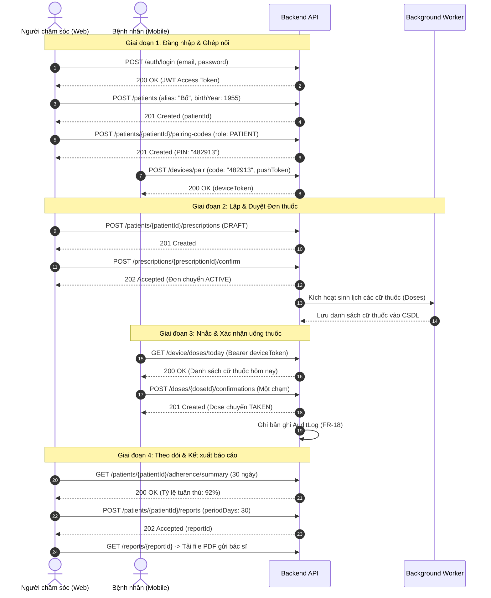

# Tài Liệu Giải Thích Chi Tiết Đặc Tả API (OpenAPI Specification)

> **Dự án:** Hệ thống hỗ trợ theo dõi điều trị ngoại trú bệnh nhân cao tuổi mắc Đái tháo đường Type 2  
> **Nhóm phát triển:** N01-01, Kỹ thuật phần mềm ứng dụng, ĐHBK Hà Nội  
> **Phiên bản:** `1.0.0-sprint1` | **Chuẩn đặc tả:** OpenAPI 3.0.3  
> **Tệp gốc:** [`openapi.yaml`](./openapi.yaml)  
> **Mock Server:** `http://localhost:8080/api/v1`

---

## 📌 MỤC LỤC
1. [Tổng quan & Kiến trúc cốt lõi](#1-tổng-quan--kiến-trúc-cốt-lõi)
2. [Cơ chế Xác thực & Phân quyền (Security)](#2-cơ-chế-xác-thực--phân-quyền-security)
3. [Phân loại Module (Tags)](#3-phân-loại-module-tags)
4. [Chi tiết từng Endpoint trong `paths`](#4-chi-tiết-từng-endpoint-trong-paths)
   - [4.1. Phân hệ Xác thực (Auth)](#41-phân-hệ-xác-thực-auth)
   - [4.2. Phân hệ Hồ sơ Bệnh nhân (Patients)](#42-phân-hệ-hồ-sơ-bệnh-nhân-patients)
   - [4.3. Phân hệ Ghép nối Thiết bị (Devices)](#43-phân-hệ-ghép-nối-thiết-bị-devices)
   - [4.4. Phân hệ Ủy quyền Người nhà (Delegates)](#44-phân-hệ-ủy-quyền-người-nhà-delegates)
   - [4.5. Phân hệ Danh mục Thuốc (Drugs)](#45-phân-hệ-danh-mục-thuốc-drugs)
   - [4.6. Phân hệ Đơn thuốc (Prescriptions)](#46-phân-hệ-đơn-thuốc-prescriptions)
   - [4.7. Phân hệ Cữ thuốc & Điểm danh (Doses)](#47-phân-hệ-cữ-thuốc--điểm-danh-doses)
   - [4.8. Phân hệ Tuân thủ & Cảnh báo (Adherence & Alerts)](#48-phân-hệ-tuân-thủ--cảnh-báo-adherence--alerts)
   - [4.9. Phân hệ Lâm sàng & Tái khám (Clinical)](#49-phân-hệ-lâm-sàng--tái-khám-clinical)
   - [4.10. Phân hệ Báo cáo PDF (Reports)](#410-phân-hệ-báo-cáo-pdf-reports)
   - [4.11. Phân hệ Nhật ký Kiểm toán (Audit)](#411-phân-hệ-nhật-ký-kiểm-toán-audit)
5. [Cấu hình Tái sử dụng & Mô hình Dữ liệu (`components`)](#5-cấu-hình-tái-sử-dụng--mô-hình-dữ-liệu-components)
6. [Các Quy tắc Nghiệp vụ Trọng yếu (Business Rules)](#6-các-quy-tắc-nghiệp-vụ-trọng-yếu-business-rules)
7. [Sơ đồ Luồng Hoạt động (Sequence Diagram)](#7-sơ-đồ-luồng-hoạt-động-sequence-diagram)

---

## 1. Tổng quan & Kiến trúc cốt lõi

File `openapi.yaml` là bản hợp đồng giao tiếp (API Contract) giữa Backend và Frontend, được xây dựng phục vụ nhu cầu phát triển song song trong Sprint 1. Hệ thống hướng đến giải quyết bài toán chăm sóc bệnh nhân cao tuổi mắc ĐTĐ type 2 với các đặc trưng:
* **Giao diện quản lý chuyên sâu (Web App):** Dành cho **Người chăm sóc (Caregiver)** thiết lập đơn thuốc, cấu hình giờ nhắc, theo dõi chỉ số, tải báo cáo.
* **Giao diện tối giản (Mobile App):** Dành cho **Bệnh nhân (Patient)** và **Người nhà (Delegate)** chỉ với thao tác "Một chạm" để xác nhận uống thuốc, không bắt bệnh nhân ghi nhớ tài khoản/mật khẩu phức tạp.
* **Bảo vệ quyền riêng tư (Zero PII):** Không lưu trữ họ tên thật, số căn cước, địa chỉ nhà của bệnh nhân trên hệ sinh thái; chỉ dùng biệt danh (`alias`) như "Bố", "Mẹ" và năm sinh (`birthYear`).
* **Tính toàn vẹn & Truy vết (Audit Logging):** Mọi thao tác ghi dữ liệu đều tự động sinh bản ghi kiểm toán theo quy định FR-18.

---

## 2. Cơ chế Xác thực & Phân quyền (Security)

Hệ thống hỗ trợ đăng nhập tài khoản cho cả hai vai trò trên web/app và ghép thiết bị tùy chọn:

| Cơ chế | Đối tượng sử dụng | Nền tảng | Cách thức cấp phát |
| :--- | :--- | :--- | :--- |
| **`caregiverAuth`** | Người chăm sóc (Caregiver) | Web và App | Email/Password và `role=CAREGIVER` qua `/auth/login` → JWT. Mặc định cho API quản lý hồ sơ. |
| **`patientAuth`** | Bệnh nhân | Web và App | Email/Password và `role=PATIENT` qua `/auth/login` → JWT. Chỉ xem hồ sơ phiên, lịch thuốc và xác nhận của bệnh nhân liên kết. |
| **`deviceAuth`** | Bệnh nhân / Người nhà | Web và App | Ghép bằng mã 6 số qua `/devices/pair` → `deviceToken`; lựa chọn bổ sung. |

---

## 3. Phân loại Module (Tags)

API được phân chia thành 11 nhóm chức năng chính:
1. `Auth`: Đăng ký, đăng nhập, làm mới token cho Người chăm sóc và Bệnh nhân.
2. `Patients`: Quản lý hồ sơ bệnh nhân được chăm sóc.
3. `Devices`: Sinh mã và ghép nối thiết bị di động.
4. `Delegates`: Quản lý người nhà bấm xác nhận uống thuốc hộ.
5. `Drugs`: Tra cứu, gợi ý thuốc từ danh mục chuẩn.
6. `Prescriptions`: Quản lý vòng đời đơn thuốc.
7. `Doses`: Quản lý cữ thuốc hàng ngày và xác nhận một chạm.
8. `Adherence`: Tổng hợp tỷ lệ tuân thủ và cảnh báo bỏ thuốc / trùng hoạt chất.
9. `Clinical`: Lưu trữ chỉ số xét nghiệm (đường huyết đói, HbA1c) và lịch tái khám.
10. `Reports`: Kết xuất báo cáo điều trị định kỳ (file PDF).
11. `Audit`: Truy vết nhật ký thao tác trên từng hồ sơ.

---

## 4. Chi tiết từng Endpoint trong `paths`

### 4.1. Phân hệ Xác thực (Auth)

* **`POST /auth/register`**
  * **Mô tả:** Đăng ký tài khoản người chăm sóc hoặc bệnh nhân mới.
  * **Security:** Không yêu cầu (`security: []`).
  * **Request Body:** `RegisterRequest` (email, password từ 8 ký tự, displayName, role mặc định CAREGIVER). PATIENT bắt buộc có pairingCode 6 số, vai trò PATIENT, còn hạn và chưa dùng để liên kết hồ sơ. Mỗi hồ sơ có một tài khoản bệnh nhân.
  * **Mã trả về:** `201 Created` (Caregiver hoặc PatientAccount), `400 Bad Request`, `409 Conflict` (email hoặc hồ sơ đã có tài khoản), `410 Gone` (mã không hợp lệ, hết hạn hoặc đã dùng).

* **`POST /auth/login`**
  * **Mô tả:** Xác thực người chăm sóc hoặc bệnh nhân qua email và mật khẩu trên cả web/app.
  * **Security:** Không yêu cầu (`security: []`).
  * **Request Body:** `LoginRequest` (email, password, role CAREGIVER hoặc PATIENT; mặc định CAREGIVER).
  * **Mã trả về:** `200 OK` (TokenPair gồm accessToken, refreshToken, expiresIn, role, accountId), `401 Unauthorized`.

* **`POST /auth/refresh`**
  * **Mô tả:** Cấp lại `accessToken` mới khi token cũ hết hiệu lực mà không cần đăng nhập lại.
  * **Request Body:** `{ refreshToken: string }`.
  * **Mã trả về:** `200 OK` (`TokenPair`), `401 Unauthorized`.

---

### 4.2. Phân hệ Hồ sơ Bệnh nhân (Patients)

* **`GET /patients`**
  * **Mô tả:** Lấy danh sách hồ sơ bệnh nhân mà người chăm sóc hiện tại đang theo dõi.
  * **Mã trả về:** `200 OK` (mảng đối tượng `Patient`), `401 Unauthorized`.

* **`POST /patients`**
  * **Mô tả:** Tạo hồ sơ bệnh nhân mới.
  * **Request Body:** `PatientCreate` (`alias`: tên gọi như "Bố", `birthYear`: năm sinh, `reminderTimes`: danh sách giờ nhắc theo các buổi sáng/trưa/chiều/tối).
  * **Mã trả về:** `201 Created` (`Patient`), `400`, `401`.

* **`GET /patients/{patientId}`**
  * **Mô tả:** Xem chi tiết hồ sơ bệnh nhân theo `patientId` (UUID).
  * **Mã trả về:** `200 OK`, `403 Forbidden` (không có quyền), `404 Not Found`.

* **`PATCH /patients/{patientId}`**
  * **Mô tả:** Cập nhật thông tin hồ sơ hoặc mốc giờ nhắc thuốc mặc định. `missedThresholdMinutes` cố định là `60`. Trong đơn thuốc, trường `items[].times` cho phép chọn giờ HH:mm riêng theo từng buổi trong `slots`.
  * **Request Body:** `PatientUpdate`.
  * **Mã trả về:** `200 OK`, `400`, `403`, `404`.

---

### 4.3. Phân hệ Ghép nối Thiết bị (Devices)

* **`POST /patients/{patientId}/pairing-codes`**
  * **Mô tả:** Người chăm sóc yêu cầu hệ thống sinh mã PIN 6 số dùng 1 lần, hiệu lực ngắn (Pairing Code) cho bệnh nhân (`PATIENT`) hoặc người nhà (`DELEGATE`).
  * **Request Body:** `{ role: "PATIENT" | "DELEGATE", delegateId?: uuid }`.
  * **Mã trả về:** `201 Created` (`PairingCode`: gồm mã `code` ví dụ "482913", vai trò, thời điểm hết hạn).

* **`POST /devices/pair`**
  * **Mô tả:** Ứng dụng di động gửi mã 6 số cùng token thông báo đẩy (`pushToken` của FCM hoặc APNs) và loại nền tảng (`platform`: ANDROID/IOS) để kích hoạt thiết bị.
  * **Security:** Không yêu cầu (`security: []`).
  * **Request Body:** `DevicePairRequest`.
  * **Mã trả về:** `200 OK` (cấp `DeviceToken` và trả về `patientAlias`), `400`, `410 Gone` (mã ghép nối đã hết hạn hoặc đã được sử dụng).

---

### 4.4. Phân hệ Ủy quyền Người nhà (Delegates)

* **`GET /patients/{patientId}/delegates`**
  * **Mô tả:** Xem danh sách người nhà được ủy quyền bấm xác nhận uống thuốc thay cho bệnh nhân.
  * **Mã trả về:** `200 OK` (danh sách `Delegate`).

* **`POST /patients/{patientId}/delegates`**
  * **Mô tả:** Thêm người nhà được ủy quyền (ví dụ: bí danh "Mẹ", quan hệ "Vợ bệnh nhân").
  * **Request Body:** `DelegateCreate`.
  * **Mã trả về:** `201 Created` (`Delegate`).

* **`DELETE /patients/{patientId}/delegates/{delegateId}`**
  * **Mô tả:** Thu hồi quyền của người nhà và ngay lập tức vô hiệu hóa token thiết bị di động liên quan.
  * **Mã trả về:** `204 No Content`, `404 Not Found`.

---

### 4.5. Phân hệ Danh mục Thuốc (Drugs)

* **`GET /drugs`**
  * **Mô tả:** Tìm kiếm gợi ý tên thuốc từ cơ sở dữ liệu danh mục chuẩn (auto-complete).
  * **Query Params:**
    * `q`: Chuỗi từ khóa tìm kiếm (tối thiểu 2 ký tự).
    * `limit`: Số kết quả trả về tối đa (1 đến 20, mặc định 10).
  * **Mã trả về:** `200 OK` (danh sách đối tượng `Drug` bao gồm tên thương mại, hoạt chất, nồng độ, dạng bào chế, số đăng ký lưu hành).

---

### 4.6. Phân hệ Đơn thuốc (Prescriptions)

* **`GET /patients/{patientId}/prescriptions`**
  * **Mô tả:** Lấy danh sách các đơn thuốc của bệnh nhân, có thể lọc theo trạng thái `status` (`DRAFT`, `ACTIVE`, `EXPIRED`, `SUPERSEDED`, `CANCELLED`).
  * **Mã trả về:** `200 OK` (danh sách `Prescription`).

* **`POST /patients/{patientId}/prescriptions`**
  * **Mô tả:** Nhập đơn thuốc mới. Lúc này đơn lưu ở trạng thái **Nháp (DRAFT)** và **chưa sinh cữ thuốc**.
  * **Request Body:** `PrescriptionInput` (ngày kê, ngày bắt đầu, ngày hẹn tái khám, danh sách thuốc và liều lượng).
  * **Mã trả về:** `201 Created` (`Prescription`), `400`.

* **`GET /prescriptions/{prescriptionId}`**
  * **Mô tả:** Xem nội dung chi tiết đơn thuốc.
  * **Mã trả về:** `200 OK`, `404`.

* **`PUT /prescriptions/{prescriptionId}`**
  * **Mô tả:** Cập nhật đơn thuốc. **Chỉ cho phép sửa khi đơn ở trạng thái DRAFT**.
  * **Mã trả về:** `200 OK`, `409 Conflict` (nếu đơn đã được xác nhận hoặc đã hủy).

* **`POST /prescriptions/{prescriptionId}/confirm`**
  * **Mô tả:** **Xác nhận đơn thuốc** (nghiệp vụ trọng yếu FR-04):
    * Đơn thuốc chuyển sang trạng thái **Hiệu lực (ACTIVE)**.
    * Đơn `ACTIVE` trước đó của bệnh nhân tự động chuyển sang **Bị thay thế (SUPERSEDED)**.
    * Các cữ thuốc trong tương lai của đơn cũ tự động hủy (`CANCELLED`).
    * Kích hoạt tiến trình ngầm tự động phân bổ và sinh ra các cữ thuốc (`Dose`) cho đơn mới.
  * **Mã trả về:** `202 Accepted` (xử lý bất đồng bộ), `409 Conflict`, `422 Unprocessable Entity`.

* **`POST /prescriptions/{prescriptionId}/cancel`**
  * **Mô tả:** Hủy bỏ đơn thuốc nháp.
  * **Mã trả về:** `200 OK`, `409 Conflict`.

---

### 4.7. Phân hệ Cữ thuốc & Điểm danh (Doses)

* **`GET /patients/{patientId}/doses`**
  * **Mô tả:** Tra cứu danh sách cữ thuốc trong khoảng ngày (`from`, `to`) và trạng thái `status` phục vụ theo dõi trên Web.
  * **Mã trả về:** `200 OK` (danh sách `Dose`).

* **`GET /device/doses/today`**
  * **Mô tả:** Lấy danh sách cữ thuốc **trong ngày hôm nay** của bệnh nhân gắn với thiết bị di động đang gọi. Giao diện được thiết kế tối giản dành riêng cho người cao tuổi.
  * **Security:** `deviceAuth` (Token thiết bị).
  * **Mã trả về:** `200 OK`, `401 Unauthorized`.

* **`POST /doses/{doseId}/confirmations`**
  * **Mô tả:** Xác nhận đã uống thuốc "Một chạm" (FR-15):
    * Xác định người uống qua token thiết bị: vai trò `PATIENT` ghi nhận trạng thái `TAKEN` (Đã uống); vai trò `DELEGATE` ghi nhận `TAKEN_BY_DELEGATE` (Đã uống hộ).
    * Uống trong khoảng từ 60 phút trước tới 60 phút sau giờ hẹn, bao gồm hai mốc, được tính đúng giờ. Khoảng này có thể qua nửa đêm. Sau mốc +60 phút là `LATE_CONFIRMED` (Xác nhận muộn); quá mốc này chưa xác nhận là `MISSED`. Phân loại theo `takenAt`, kể cả khi gửi lại ngoại tuyến.
    * **Tính bất biến:** Bản ghi xác nhận không được sửa hay xóa. Nếu người dùng ấn nhầm, thực hiện đính chính bằng cách gửi bản ghi mới có trường `correctsConfirmationId`.
  * **Security:** `deviceAuth`.
  * **Request Body:** `ConfirmationCreate` (tùy chọn).
  * **Mã trả về:** `201 Created`, `401`, `403`, `409`, `422`.

---

### 4.8. Phân hệ Tuân thủ & Cảnh báo (Adherence & Alerts)

* **`GET /patients/{patientId}/adherence/summary`**
  * **Mô tả:** Thống kê mức độ tuân thủ điều trị theo chu kỳ (tham số `days`: 7, 30 hoặc 90 ngày; mặc định 30 ngày).
  * **Dữ liệu trả về:** `totalDoses`, số lần `taken`, `takenByDelegate`, `lateConfirmed`, `missed`, và tỷ lệ tuân thủ `adherenceRate` (từ 0 đến 1).

* **`GET /patients/{patientId}/alerts`**
  * **Mô tả:** Lấy danh sách cảnh báo (tham số `unreadOnly`: lọc cảnh báo chưa đọc).
  * **Các loại cảnh báo:**
    * `DOSE_MISSED`: Quên uống thuốc quá thời hạn cho phép.
    * `VISIT_UPCOMING`: Sắp tới lịch hẹn tái khám.
    * `DUPLICATE_INGREDIENT`: Trùng lặp hoạt chất giữa các thuốc trong đơn.
  * **Ghi chú:** Ngoài REST API, các cảnh báo khẩn cấp còn được đẩy theo thời gian thực qua kênh WebSocket `/ws/alerts`.

---

### 4.9. Phân hệ Lâm sàng & Tái khám (Clinical)

* **`GET /patients/{patientId}/lab-results`** & **`POST ...`**
  * **Mô tả:** Lịch sử và thêm mới kết quả xét nghiệm định kỳ sau mỗi đợt khám.
  * **Loại xét nghiệm (`LabTestType`):** `FASTING_GLUCOSE` (đường huyết lúc đói), `HBA1C` (chỉ số gắn kết đường trong hồng cầu), `POSTPRANDIAL_GLUCOSE` (đường huyết sau ăn), `OTHER`.

* **`GET /patients/{patientId}/appointments`** & **`POST ...`**
  * **Mô tả:** Quản lý lịch hẹn tái khám với bác sĩ chuyên khoa.
  * **Thuộc tính:** `visitDate` (ngày hẹn), `remindDaysBefore` (nhắc trước bao nhiêu ngày, mặc định 2 ngày), `note` (ghi chú dặn dò).

---

### 4.10. Phân hệ Báo cáo PDF (Reports)

* **`POST /patients/{patientId}/reports`**
  * **Mô tả:** Gửi yêu cầu khởi tạo báo cáo điều trị (PDF) gửi bác sĩ cho khoảng thời gian `periodDays` (30, 60 hoặc 90 ngày).
  * **Xử lý ngầm:** Trả về `202 Accepted` kèm theo thông tin tác vụ `ReportJob` ở trạng thái `QUEUED` hoặc `PROCESSING`.

* **`GET /reports/{reportId}`**
  * **Mô tả:** Tra cứu tiến độ sinh báo cáo. Khi trạng thái chuyển sang `READY`, API cung cấp đường dẫn `downloadUrl` để tải file.

---

### 4.11. Phân hệ Nhật ký Kiểm toán (Audit)

* **`GET /patients/{patientId}/audit-logs`**
  * **Mô tả:** Phân trang danh sách nhật ký thao tác trên hồ sơ bệnh nhân (tuân thủ yêu cầu chức năng FR-18).
  * **Query Params:** `page` (trang, mặc định 1), `size` (kích thước trang, 1 đến 100, mặc định 20).
  * **Cấu trúc Log:** `{ timestamp, userId, actionType, status, targetType, targetId }`.

---

## 5. Cấu hình Tái sử dụng & Mô hình Dữ liệu (`components`)

### 5.1. Mô hình Phản hồi Lỗi chuẩn (`Error`)
Mọi phản hồi lỗi (4xx, 5xx) đều có cấu trúc đồng nhất:
```json
{
  "code": "DOSE_ALREADY_CONFIRMED",
  "message": "Cữ thuốc này đã được xác nhận",
  "details": [
    {
      "field": "doseId",
      "issue": "Trạng thái hiện tại không cho phép xác nhận thêm"
    }
  ]
}
```

### 5.2. Các Enum quan trọng

| Enum | Các giá trị | Ý nghĩa nghiệp vụ |
| :--- | :--- | :--- |
| **`TimeSlot`** | `MORNING`, `NOON`, `AFTERNOON`, `EVENING` | Các buổi dùng thuốc trong ngày (Sáng, Trưa, Chiều, Tối). |
| **`DeviceRole`** | `PATIENT`, `DELEGATE` | Vai trò của thiết bị di động (Chính bệnh nhân hoặc Người nhà). |
| **`PrescriptionStatus`** | `DRAFT`, `ACTIVE`, `EXPIRED`, `SUPERSEDED`, `CANCELLED` | Vòng đời đơn thuốc: Nháp -> Hiệu lực -> Bị thay thế / Hết hạn / Đã hủy. |
| **`DoseStatus`** | `SCHEDULED`, `PENDING`, `TAKEN`, `TAKEN_BY_DELEGATE`, `MISSED`, `LATE_CONFIRMED`, `CANCELLED` | Trạng thái cữ thuốc: Lên lịch -> Chờ uống -> Đã uống / Đã uống hộ / Bỏ lỡ / Uống muộn / Hủy theo đơn. |
| **`LabTestType`** | `FASTING_GLUCOSE`, `HBA1C`, `POSTPRANDIAL_GLUCOSE`, `OTHER` | Các loại xét nghiệm cận lâm sàng phục vụ điều trị ĐTĐ type 2. |
| **`ReportStatus`** | `QUEUED`, `PROCESSING`, `READY`, `FAILED` | Trạng thái hàng đợi xuất file báo cáo tổng hợp. |

---

## 6. Các Quy tắc Nghiệp vụ Trọng yếu (Business Rules)

1. **FR-04 (Chuyển tiếp Đơn thuốc):** Một bệnh nhân tại một thời điểm chỉ có tối đa 1 đơn thuốc ở trạng thái `ACTIVE`. Khi xác nhận đơn mới, đơn cũ tự động chuyển sang `SUPERSEDED`, các cữ thuốc trong tương lai của đơn cũ bị hủy (`CANCELLED`).
2. **FR-15 (Điểm danh thuốc Một chạm & Bất biến):** Giao diện điện thoại chỉ cần 1 chạm là hoàn thành ghi nhận. Các bản ghi điểm danh mang tính chất lịch sử bất biến (Append-only), không chỉnh sửa trực tiếp mà thực hiện qua cơ chế đính chính (Correction).
3. **FR-18 (Kiểm toán bảo mật):** Tất cả hành động làm thay đổi dữ liệu (tạo hồ sơ, sửa đơn, ghép nối thiết bị, điểm danh thuốc, thu hồi quyền) đều phải ghi nhận log vào bảng `AuditLog` kèm ID người thực hiện và trạng thái kết quả.
4. **An toàn dùng thuốc (Rule Engine):** Khi đơn thuốc chứa từ 2 loại thuốc trở lên có chung hoạt chất (`activeIngredients`), hệ thống tự động sinh cảnh báo `DUPLICATE_INGREDIENT` để phòng tránh ngộ độc/quá liều.

---

## 7. Sơ đồ Luồng Hoạt động (Sequence Diagram)


